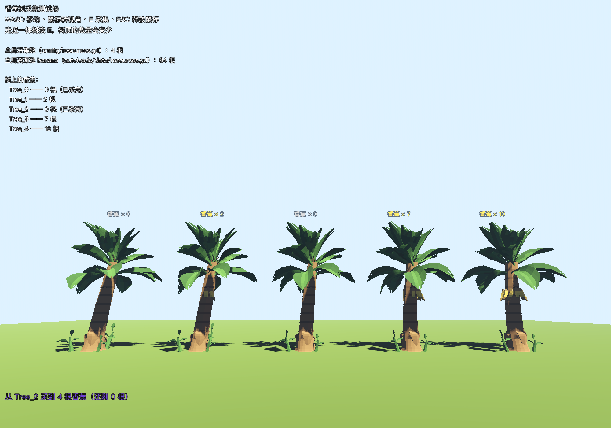
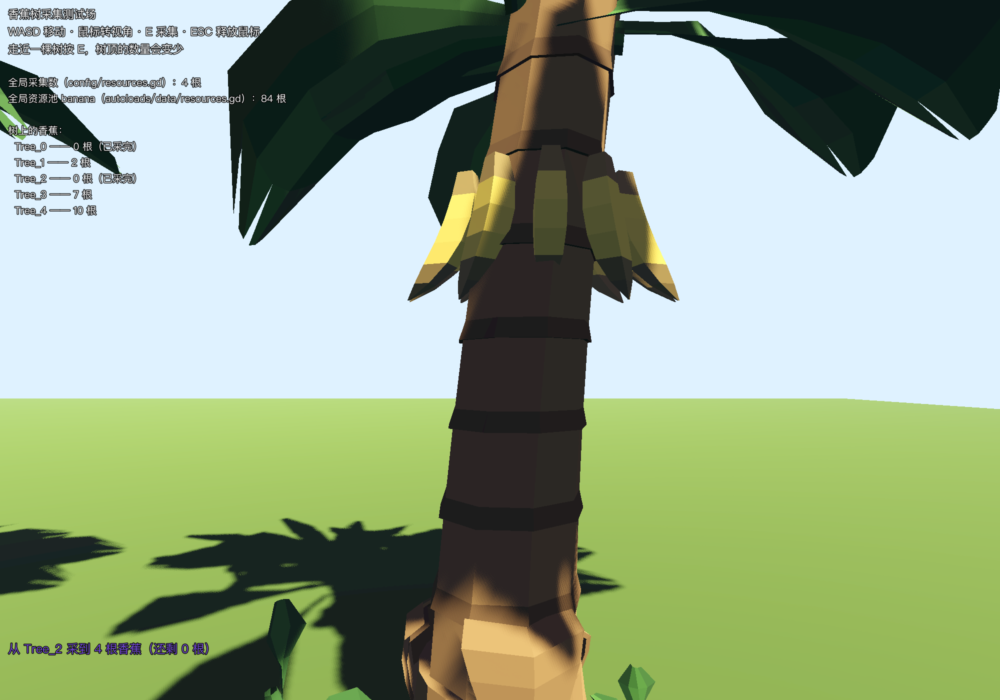

# 可采集香蕉树组件（`components/banana-tree/gatherable_banana_tree.tscn`）

一棵**能采**的香蕉树：树上还剩多少根香蕉就显示多少，走近按 `E` 采走，
采到的数量记进全局配置。

```
components/banana-tree/
├── gatherable_banana_tree.tscn        组件场景（拖进任何场景就能用）
├── gatherable_banana_tree.gd          组件脚本（数量 / 采集 / 数量显示）
├── gatherable_banana_tree_test.tscn   测试场（一排树 + Player + HUD）
├── gatherable_banana_tree_test.gd     测试场脚本（HUD 显示全局配置数值）
├── preview.png                        测试场截图
├── preview_bunch.png                  10 根香蕉绕着树干的近景
└── README.md                          本文件
```



---

## 1. 场景结构

```
GatherableBananaTree (Node3D)          ← 组件脚本
├── Tree                               ← 树模型（banana-tree-tall/low_poly_banana_tree.glb）
├── banana_0 … banana_9                ← 10 个固定挂果位（banana.glb 的实例）
├── CountLabel (Label3D)               ← 树顶的数量标签："香蕉 × 10"
├── InteractArea (Area3D)              ← 采集范围（球，半径 = interact_radius）
│   └── CollisionShape3D (SphereShape3D)
└── Trunk (StaticBody3D)               ← 树干碰撞（层 2 = vegetation）
    └── CollisionShape3D (CylinderShape3D)
```

| 节点 | 作用 | 碰撞层 |
| --- | --- | --- |
| `banana_0` … `banana_9` | **固定的挂果位**，各自是一根香蕉（`banana.glb` 的实例） | — |
| `InteractArea` | 检测玩家有没有走进采集范围 | mask = 16（creature，只有玩家） |
| `Trunk` | 挡人，树干不能穿过去 | layer = 2（vegetation，见 AGENTS.md 碰撞层约定） |

### 香蕉是场景里固定的节点，不是脚本生成的

**10 个挂果位写死在 `.tscn` 里**（`banana_0` … `banana_9`），
脚本只按 [member banana_count] 切它们的 `visible` ——
**不生成、不删除、不摆位置**。所以：

- 这棵树**最多 10 根香蕉**（`banana_count` 被钳在 0~10）
- 编辑器里拖一个挂果位就能改布局，不用改代码
- 没有 `@tool` 脚本在运行时拼果串 —— 场景里看到的就是场景里摆的

> 挂果位的位置是按**假茎**算的（见下一节），改位置要改 `.tscn` 里的
> `transform`（脚本不会去动它们）。

---

## 2. 10 个挂果位的位置（绕着假茎一圈）



挂果位是**摆好的**，位置按假茎（树干）的真实形状算：

- **高度 y = 2.25 m**：假茎到 3.26 m 就是叶冠了，叶片在 2.5 m 以上是密实的
  （实测叶片的最近半径只有 0.03~0.15 m，全贴着树干）——
  挂果位放在**叶冠下方的空档**里才看得见
- **绕一圈**：10 个位置在假茎中轴周围均分（每 36°）
- **半径 R = 0.30 m**：假茎在 2.25 m 处的半径是 0.257 m，
  加上香蕉半宽（0.053 m）和一点余量 —— 香蕉的背面刚好贴着树皮
- **朝向**：每根香蕉自带的 `+X` 弯曲方向指向外侧
  （`rotation_y = θ - 90°`），所以十根香蕉都朝外弯、垂在树干上

| | 值 |
| --- | --- |
| 挂果位高度 | 2.25 m |
| 圆心（假茎中轴） | (0.167, 2.25, 0.073) |
| 半径 | 0.30 m |
| 角度间隔 | 36°（10 个 = 一圈） |

> 假茎是**弯**的（中轴随高度往 +X 偏），所以圆心不是世界原点，
> 是按那个高度处的中轴算的。

---

## 3. 参数

| 参数 | 默认 | 说明 |
| --- | --- | --- |
| `banana_count` | **0** | 树上还剩多少根香蕉（0~10）。0 = 空树（挂果位全部隐藏） |
| `regrow_seconds` | 0 | 采空之后多少秒长回一根。0 = 不再长 |
| `interact_radius` | 2.8 | 采集半径（米） |
| `harvest_all_at_once` | true | 一次采完，还是只采 `harvest_amount` 根 |
| `harvest_amount` | 1 | 一次采多少根（`harvest_all_at_once = false` 时生效） |
| `show_count_label` | true | 是否在树顶显示数量 |
| `label_prefix` | "香蕉 ×" | 数量标签的前缀 |
| `label_height_offset` | 0.6 | 标签挂在树顶往上多少米 |
| `hide_label_when_empty` | false | 空树时把标签藏起来 |

**显示逻辑**：`banana_count = N` → `banana_0` … `banana_{N-1}` 可见，其余隐藏。

---

## 4. 采集交互

1. 玩家走进 `interact_radius` → 这棵树才开始处理按键
   （`Area3D.body_entered` → `set_process_unhandled_input(true)`）
2. 按输入动作 **`interact`**（默认 `E`，见 `project.godot`）→ 采集
3. **只有最近的一棵树响应**：站在两棵树中间时，采的是更近的那棵，
   不会一次按键采好几棵
4. 采到的数量：
   - 树的 `banana_count` 减少 → 对应的挂果位隐藏 → 标签数字跟着变
   - 写进**全局配置**（见下一节）
   - 发出 `bananas_collected(amount)` / `harvested(tree, amount)` 信号

树空了、或者玩家不在范围内，按 `E` 什么也不会发生。

---

## 5. 记账：采到的香蕉去了哪

**全局配置 = `res://config/resources.gd`（`ResourcesConfig`）**：

```gdscript
ResourcesConfig.add_collected_bananas(taken)   # 累加"累计采集数"
ResourcesConfig.get_collected_bananas()          # 读回来
```

这个静态变量是**全局的**（`ResourcesConfig` 是全局类，静态变量在所有场景共享），
采集的时候同时把数量同步到**全局资源池**
（`autoloads/data/resources.gd` 里 `"banana"` 的数量），HUD 顶栏读的就是它。

> `config/resources.gd` 里同步资源池时用的是**运行期查找**
> （`Engine.get_main_loop()` → 找叫 `Resources` 的自动加载节点），
> 不是直接引用自动加载名 —— 那个自动加载脚本会 preload `config/resources.gd`，
> 直接引用会形成循环依赖。

---

## 6. 性能（大世界里树有几千棵）

- `_process` **默认关着**：只有 `regrow_seconds > 0` 的树才需要每帧回调
- `_unhandled_input` **默认关着**：只有玩家走进采集范围的树才会处理按键
  （否则几千棵树每帧都要被问一遍"按 E 了吗"）
- 采集范围用 `Area3D` + `body_entered` 开关，不用每帧查重叠

---

## 7. 测试场（`gatherable_banana_tree_test.tscn`）

- 一排 **5 棵树**（编辑状态就摆好了，不是运行时生成的），
  香蕉数量分别是 **0 / 2 / 4 / 7 / 10**（上限 10）
- 一个 `Player`（`components/player/player.tscn`），从 z = 6 出发面向树
- HUD 实时显示：
  - 全局采集数（`config/resources.gd`）
  - 全局资源池 `banana` 数量（`autoloads/data/resources.gd`）
  - 每棵树还剩多少根
  - 最近一次采集的结果

操作：`WASD` 移动 · 鼠标转视角 · `E` 采集 · `ESC` 释放鼠标

跑法（在项目根目录）：

```bash
godot --path . components/banana-tree/gatherable_banana_tree_test.tscn
```

---

## 8. 共享组件 `BananaTree` 的改动

这个组件现在**不再用 `BananaTree` 摆果串**（香蕉是场景里固定的节点了），
树模型直接用 `assets/models/banana-tree-tall/low_poly_banana_tree.glb`。
`components/vegetation/banana_tree/banana_tree.gd` 和
`banana_bunch.gd` 里加的接口是**纯加法**，原有行为不变
（自检脚本 41 项全过），留着给别的地方用：

| 新接口 | 在哪 | 干什么 |
| --- | --- | --- |
| `get_stalk_height_range() -> Vector2` | BananaTree | 假茎（树干）的高度范围 |
| `configure_bunches(count, per_bunch, seed, first_ratio, step_ratio, hug)` | BananaTree | 一次改一批果串参数、只重建一次 |
| `hug_stalk`（导出参数） | BananaTree | 果串直接贴在假茎表面，**不生成果柄** |
| `get_bunch_radius() -> float` | BananaBunch | 这一把香蕉的横向半径（实测网格顶点） |

> ⚠️ 这两个 `.tscn` 是**手写的文本**。用编辑器改实例的导出属性时，
> 留意实例的 property override 要写**属性名**（`banana_count = 3`），
> 别写成了别的名字 —— 名字对不上时值会落到别的属性上。
>
> ⚠️ 脚本是 `@tool` 的：编辑器里改 `banana_count` 会切挂果位的 `visible`，
> **场景会被标记为已修改**（存盘时会把 `visible = false` 写进去）。
> 这是 Godot `@tool` 的正常行为，不是 bug。
