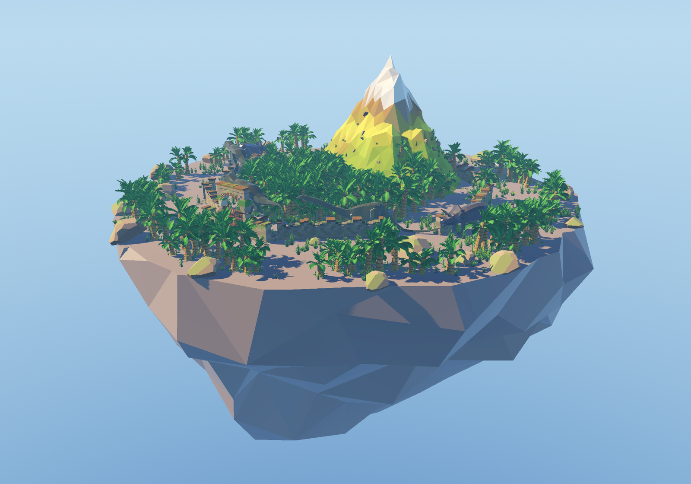
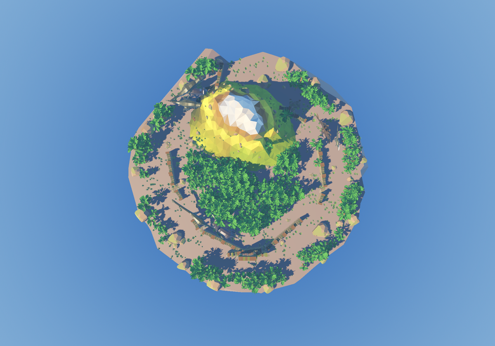
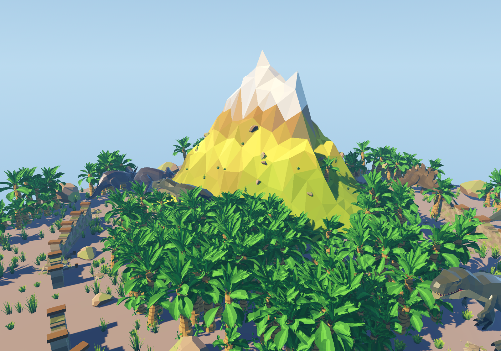
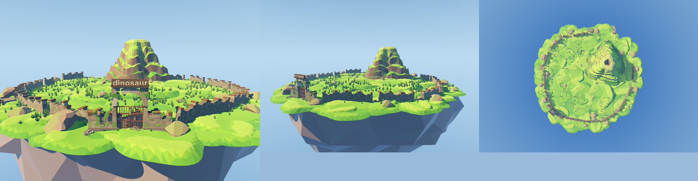

# 低模岛组件

`components/island/island.tscn` — 一座可直接实例化的 low-poly 漂浮岛：
岛北侧一座雪峰低山，**平顶岩台**就是岛面（碰撞也是模型自带的），
岛缘和山体上散落着石头，草丛成簇分布，
**大片香蕉林按噪声图铺满全岛**，林间留出环岛小路和支路，空地上站着恐龙。

> 2026-11：岛面原先盖着一层**烘出来的草毯**（`Ground/Terrain`），现在删掉了 ——
> 岛面直接用岛体模型自带的岩台（y = 0，半径 29.25–34.5 m）。
> 草毯比岩台大一圈，草毯外圈那圈树和石头有一半悬在岛外；
> 删掉草毯后这些道具全部重新贴回岩台以内（详见 `AGENTS.md` 的「岛面就是岩台」）。







## 节点结构

## 两个场景

| 场景 | 内容 | 谁用 |
| --- | --- | --- |
| `terrain.tscn` | **只有地形**：岩台（`sky-island-basic.glb`）+ 山体（`low_poly_low_mountain.glb`）+ 山体碰撞 | 大世界、以及下面这个展示岛 |
| `island.tscn` | 地形 + 环境/灯光/预览相机 + 草石 + 围墙 + 香蕉林 + 恐龙 | 单独打开 / 截图 |

拆开的原因：以前这些内容挤在一个场景里，大世界靠 `show_presentation /
show_scatter / ...` 在**运行时**隐藏 —— 而脚本不是 `@tool`，编辑器里开关不生效，
于是"编辑器里看得见一堆巨树，跑起来又全没了"。现在大世界**只实例化
`terrain.tscn`**，编辑器看到的和跑起来的一致，也不需要任何隐藏开关。

```
Island (Node3D)                      ← island.tscn：展示岛
├── Terrain              terrain.tscn 实例（岩台 + 山体，唯一真源）
├── WorldEnvironment      程序化天空 + 雾 + Filmic 色调
├── Sun                   主光（带阴影）
├── FillLight             冷色补光（无阴影）
├── BounceLight           从下方来的云海反光（无阴影）
├── PreviewCamera         当前相机，用于单独打开场景时取景
├── （Terrain 里）
│   ├── IslandBase        sky-island-basic.glb，scale 13，台面刚好落在 y = 0
│   │   └── SkyIsland     台面自带碰撞（glb 的 `-col` 节点）
│   └── Mountain          low_poly_low_mountain.glb，scale 0.8，偏心摆在岛北侧
│       └── LowMountain
├── Scatter
│   ├── Rocks             64 块 low_poly_rock
│   │   ├── RimBoulders   岛缘大石
│   │   ├── FieldBoulders 台面上的石头与前景石组
│   │   ├── MountainFoot  山脚碎石
│   │   └── MountainBoulders 山腰坡面上的石头
│   └── Grass             872 丛 grass_tuft / grass_clump
│       ├── IslandGrass
│       └── MountainGrass
├── ParkPerimeter         沿岛缘内缩的断续围墙 + 大门
└── Vegetation            香蕉树林（MultiMesh）+ 恐龙
    ├── Trees
    │   ├── ShortTrees    MultiMeshInstance3D（174 棵矮款香蕉树）
    │   └── TallTrees     MultiMeshInstance3D（153 棵高款香蕉树）
    ├── Dinosaurs         10 只恐龙，每只一个场景 + 一条烘好的巡逻路线
    │   └── TRex_00 …     instances of components/vegetation/dinosaur/*.tscn
    └── TreeCollision     运行时生成：1 个 StaticBody3D + 327 个共享圆柱形状
```

## 关键尺度

| 元素 | 值 | 说明 |
| --- | --- | --- |
| 岛屿本体 | scale **13** | glb 台面局部高度 0.71 → 缩放后 9.23 m，节点 y = −9.23，台面落到 **y = 0** |
| 岛屿台面 | 半径 **29.25–34.5 m**，高度 **y = 0** | 模型自带的岩盘（`sky-island-basic.glb` 的 `-col` 节点），碰撞也是它给的 |
| 山体 | scale **0.80**，yaw −18° | `low_poly_low_mountain.glb`；山脚半径约 **9–17 m**，峰顶约 **17.8 m**；含水下裙边总高约 18.6 m |
| 石头 | 2.9 m 模型，scale 0.20–1.7 | 岛缘大石、台面石、山脚碎石、山腰石四档 |
| 草 | 0.41–0.77 m 模型，scale 0.7–1.7 | 872 丛，台面 + 山坡 |
| 香蕉树 | 矮款 2.66 m / 高款 4.77 m | 327 棵（174 矮 + 153 高），scale 0.86–1.16，按噪声密度铺开 |
| 恐龙 | 2.2 m（迅猛龙）– 17 m（蜥脚龙） | 10 只，骨架实测体长后缩放到真实尺寸；每种一个场景，行为在 `components/ai/dinosaur/` |

所有变换都已烘进 `.tscn`（静态摆放，无运行时随机）。同一份场景每次打开的位置完全一致。

## 四个比例 / 层次问题的处理

1. **山与岛的比例**：岛体从 scale 11 放大到 13（台面直径约 62 m），山体是
   `low_poly_low_mountain.glb`（自带 22.5 m 峰顶的双峰雪锥），场景里按 scale 0.80 摆
   （峰顶约 17.8 m、山脚宽约 26 m），山不再占掉半个岛，台面和石头有足够的空间。
   换山时**山脚落点要重新对**：新山更陡，同一个高度对应的半径不一样，
   山上的草石得用 `ground_scatter/resnap_scatter.gd` 的 `slide` 模式重贴，
   再重烘 MultiMesh（`bake_scatter.gd`，**不能**加 `--headless`）。
2. **山脚过渡**：山体自带 −0.7 m 的裙边，埋进台面里，所以看不到垂直的墙；
   山脚那一圈碎石（`MountainFoot`）把接缝打散。

## 光照 / 氛围

- 左前上方暖色主光拉出长阴影，冷色补光把暗面提亮，下方反光模拟云海反射。
- 程序化天空 + 很淡的雾 + Filmic + 饱和度 / 对比度调整，保持 low-poly 的高饱和面感。
- `PreviewCamera` 已设为 current，直接按 F6 就能看到预览图的角度。

## 碰撞

`island.gd` 在 `_ready()` 里只给**山体**补碰撞：每个 `MeshInstance3D` 挂一个
`StaticBody3D + CollisionShape3D`（三角面碰撞）。

岛面（台面）不用管：`sky-island-basic.glb` 里名字带 `-col` 的节点导入时
自带一个 `StaticBody3D`，高度固定在 **y = 0**。

草地不参与碰撞。石头由 `ground_scatter.gd` 用"一个 `StaticBody3D` + N 个共享凸包
`CollisionShape3D`"补出来。

如果只想要视觉、不想要碰撞，把 `Island.build_collision` 设为 `false` 即可。

## 园区入口 `ParkPerimeter`

`island.tscn` 里挂了一个 `ParkPerimeter` 节点：**沿岛缘内缩一圈的断续围墙 + 大门**，
围住全岛 **37%**（1291 / 3504 m²），山体偏心坐在里面。

```
ParkPerimeter                   ← 整体可挪动（改半径/跨度要重跑烘焙，见下）
  ├─ Gate                       ← 大门（components/island/park_gate/）
  ├─ Walls/                     ← 30 段残墙（2.9 m/段，长短不一的连续段之间是塌口）
  └─ Debris/                    ← 碎石堆（塌口/门墩/围内散落）+ 3 段倒伏墙
```



### 布局规则

| 项 | 值 | 说明 |
| --- | --- | --- |
| 围墙走向 | **沿岛缘内缩 10.5 m** | 每个角度射线量岛缘半径（29–34 m），墙不会挂在崖坡上 |
| 覆盖角度 | 门 **±140°** | 背后留 80° 豁口 |
| 围住面积 | **1291 m² = 37%** | 岛面实测 3504 m² |
| 山体偏移 | **13 m**（朝 264°） | 约可用进深的 75%，不再是对称同心圆 |
| 单段墙长 | 2.90 m | 与 `ruined_wall` 资产一致，段内接缝严丝合缝 |
| 连续段长度 | 1–5 段（2.9–14.5 m） | **长短不一**，每段之后必是塌口 |
| 塌口长度 | 1.2–3.6 m | 塌口处丢碎石，部分再倒一段墙 |
| 贴地 | 逐段射线取地面高度 | 相邻 2.9 m 高差 > 0.42 m 就强制断开；外侧 2.5 m 陡降 > 1.2 m 也断开（崖边塌口） |

破败感不是靠贴图，靠三件事：**断续**（长短不一的残段 + 塌口）、**沉降**
（每段独立贴地 + 28% 的段额外下沉，墙头高低不齐）、**碎片**（塌口碎石、倒伏墙、门口撞击堆）。

### 改布局 = 改参数 + 重跑烘焙

场景是**烘出来的静态节点**，不是运行时生成：墙要贴在真实地面高度上，而地面碰撞是
`island.gd` 运行时才补的，编辑器里量不到。所以参数改完要重烘：

```bash
cd /Users/zhouyunge/Documents/godot/open-jurassic-island
/Applications/Godot.app/Contents/MacOS/Godot --path . \
  --script res://components/island/park_perimeter/bake_perimeter.gd -- \
  res://components/island/park_perimeter/park_perimeter.tscn
```

参数都在 `bake_perimeter.gd` 顶部（`INSET` / `SPAN_DEG` / `RUN_MAX` / `GAP_*` /
`STEP_BREAK` / `SINK_VARIANCE` …），末尾可再传一个随机种子换一套破败分布。
这份脚本输出的是**节点变换**（不是 MultiMesh 实例变换），所以 `--headless` 也能跑 ——
实测射线照样打得到地面。

> ⚠️ **别把 `ParkPerimeter` 挪进 `Island` 节点下面**。主场景 `jurassic-island.tscn` 给
> `Island` 加了 `Transform3D(32.258, 0, 0, 0, 20.9677, 0, 0, 0, 32.258, ...)` ——
> **32 倍、而且 Y 轴非等比**，大门进去会被拉成 340 m 宽的假门楼。
> 要放进主场景，请摆在 `Island` 的**兄弟位置**（1:1 米制）。

## 草石现在是 MultiMesh

`Scatter` 不再是上千个道具节点，而是实例化了
`components/island/ground_scatter/island_scatter.tscn`：

```
Scatter                        ← MultiMesh 散布（17 个节点 / 936 个实例 / 8 个 draw call）
  ├─ Grass
  │   ├─ IslandGrass           ← 分组容器（保留原来的层级语义）
  │   │   ├─ GrassTuft         ← MultiMeshInstance3D
  │   │   └─ GrassClump        ← MultiMeshInstance3D
  │   └─ MountainGrass
  │       ├─ GrassTuft / GrassClump
  ├─ Rocks
  │   ├─ RimBoulders / FieldBoulders / MountainFoot / MountainBoulders
  │       └─ Rock              ← MultiMeshInstance3D
  └─ RockCollision             ← 运行时生成：1 个 StaticBody3D + 64 个共享凸包形状
```

- 草的 MultiMesh 关掉了投影（`cast_shadow = 0`），上千棵草的阴影是纯浪费。
- 石头碰撞由 `ground_scatter.gd` 在运行时补，形状资源共享，所以 64 块石头只占一份形状数据。
- 位置数据的源是 `ground_scatter/island_scatter.json`，改完要重跑
  `bake_scatter.gd`。细节和踩过的坑见 `ground_scatter/README.md`。
- `island.gd` 的 `collision_groups` 里**没有** `Scatter/Rocks`：MultiMesh 不是
  `MeshInstance3D`，三角面补碰撞那套扫不到它，石头碰撞改由散布组件自己负责。
- 草石要**贴着岛面**：岛面（台面）是模型自带的碰撞面，贴地射线直接打它；
  `resnap_scatter.gd` 的 `project` 模式还会把落在岛外的道具**收回岛缘**
  （草毯移除之后，岛面比草毯小一圈，不收就会有石头悬在岛外）。

## 香蕉树林 + 恐龙也是 MultiMesh

`Vegetation` 节点实例化了
`components/island/vegetation/island_vegetation.tscn`：

```
Vegetation                    ← 290 棵树（1 个节点 / 4 个 draw call）
  ├─ Trees
  │   ├─ ShortTrees           ← MultiMeshInstance3D（116 棵矮款，2.66 m）
  │   └─ TallTrees            ← MultiMeshInstance3D（95 棵高款，4.77 m）
  ├─ Dinosaurs                ← 10 只（T-Rex / 三角龙 / 剑龙 / 副栉龙 / 迅猛龙 / 蜥脚龙）
  └─ TreeCollision            ← 运行时生成：1 个 StaticBody3D + 211 个共享圆柱形状
```

- 布局按 **FastNoiseLite 噪声**采样：密度场决定哪里是林子、款式场决定高矮交错，
  环岛小路 + 三条支路留出通道（冒险者能跑，恐龙能巡逻，林子里的树当掩体）。
- **烘死的静态场景**，没有运行时随机、也没有程序化生成：位置数据的源是
  `vegetation/island_vegetation.json`，产物是 `island_vegetation_*_trees.res`
  （二进制 MultiMesh）。改完要重跑 `vegetation/bake_vegetation.gd`。
- 树是**真的挡路**：树干碰撞在运行时补（矮款 / 高款各共享一份圆柱形状），
  玩家可以贴着树躲恐龙。
- 恐龙是**独立场景**（`island_dinosaurs.tscn`），不跟树挤在一个场景里；
  行为在独立 AI 模块 `components/ai/dinosaur/`（感官 → 黑板 → 决策 → 转向 → 身体）。
- 恐龙在**植被层以外**：碰撞掩码只勾地面和生物，所以树、围墙、石头都挡不住
  它们 —— 巡逻不会卡住；但**视线**会被树挡住，玩家能躲树（细节见
  `components/ai/dinosaur/README.md`）。
- 细节、参数和踩过的坑见 `vegetation/README.md`。
