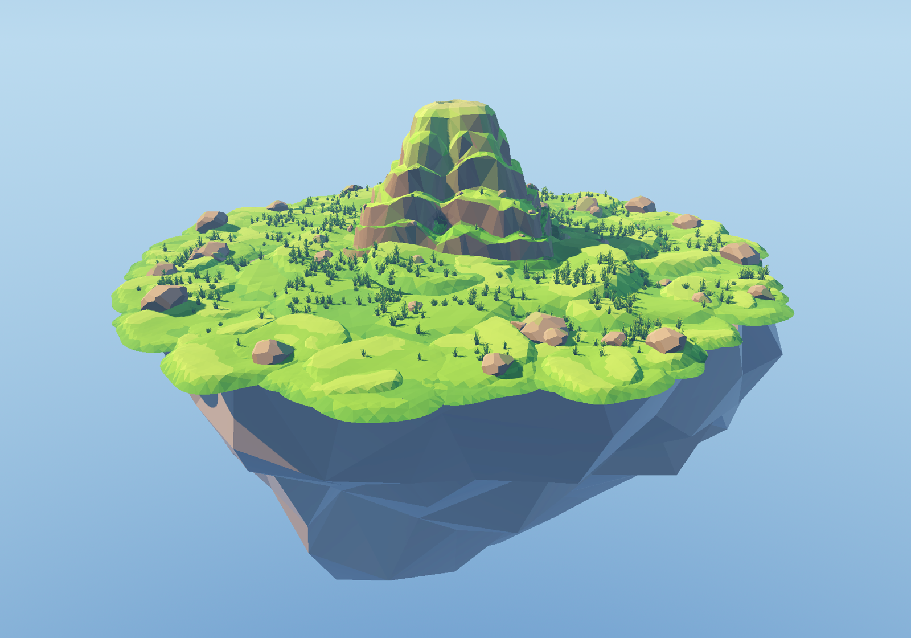
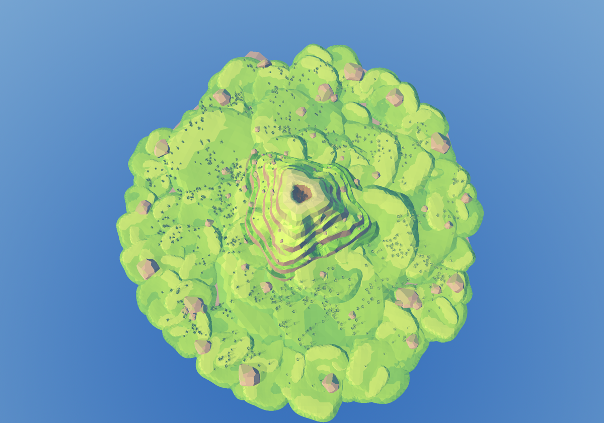
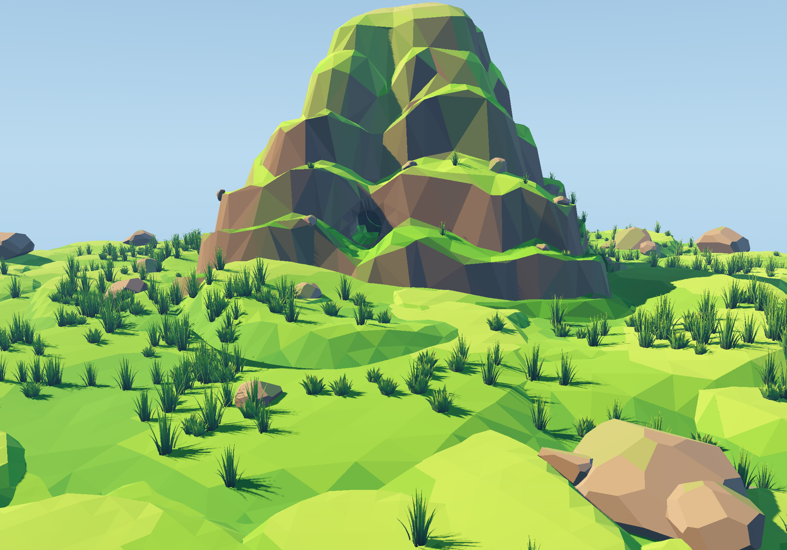

# 低模岛组件

`components/island/island.tscn` — 一座可直接实例化的 low-poly 漂浮岛：
岛中央一座台地山，绿色草毯覆盖岛面，岛缘和山体上散落着石头，草丛成簇分布。







## 节点结构

```
Island (Node3D, island.gd)
├── WorldEnvironment      程序化天空 + 雾 + Filmic 色调
├── Sun                   主光（带阴影）
├── FillLight             冷色补光（无阴影）
├── BounceLight           从下方来的云海反光（无阴影）
├── PreviewCamera         当前相机，用于单独打开场景时取景
├── IslandBase            sky-island-basic.glb，scale 13，台面刚好落在 y = 0
│   └── SkyIsland
├── Ground                plain_terrain.glb × 116，多尺度拼成连续草毯
├── Mountain              low_poly_nest_mountain.glb，scale 0.3，位于原点
│   └── NestMountain
└── Scatter
    ├── Rocks             66 块 low_poly_rock
    │   ├── RimBoulders   岛缘大石
    │   ├── FieldBoulders 草地上的石头与前景石组
    │   ├── MountainFoot  山脚碎石
    │   └── MountainBoulders 山腰台地上的石头
    └── Grass             922 丛 grass_tuft / grass_clump
        ├── IslandGrass
        └── MountainGrass
```

## 关键尺度

| 元素 | 值 | 说明 |
| --- | --- | --- |
| 岛屿本体 | scale **13** | glb 台面局部高度 0.71 → 缩放后 9.23 m，节点 y = −9.23，台面落到 **y = 0** |
| 岛屿台面 | 半径约 **29.5–34.5 m** | 棕色岩台，外圈只留 1–3 m 薄岩唇，其余用草块和边缘碎块盖住 |
| 山体 | scale **0.30**，yaw −18° | 山脚半径约 **11–16 m**，峰顶约 **15.6 m**；含水下裙边总高约 18.6 m |
| 草地地形块 | 10 m 模型，**五种尺度** | 大块 scale 1.7–2.45 / 中块 1.0–1.6 / 小块 0.55–0.95 / 补缝块 0.7–1.2 / 岛缘碎块 0.55–1.1 |
| 山脚过渡 | 20 块抬升地形 | 只叠在草毯上（不互相堆叠），把山脚埋进缓坡里 |
| 石头 | 2.9 m 模型，scale 0.20–1.7 | 岛缘大石、草地石、山脚碎石、山腰石四档 |
| 草 | 0.41–0.77 m 模型，scale 0.7–1.7 | 约 100 个草簇，岛面 + 山腰台地 |

所有变换都已烘进 `.tscn`（静态摆放，无运行时随机）。同一份场景每次打开的位置完全一致。

## 四个比例 / 层次问题的处理

1. **山与岛的比例**：岛体从 scale 11 放大到 13（台面直径约 62 m），山体保持 scale 0.30
   （峰顶约 15.6 m、山脚宽约 26 m），山不再占掉半个岛，草毯和石头有足够的空间。
2. **岛缘裸面**：草块分五档尺度铺，外圈再补两圈岛缘碎块；覆盖检测会优先填掉
   绿色草毯里的空洞，最后只剩一圈很薄的棕色岩唇。
3. **地形不机械**：大/中/小/补缝/岛缘五档随机尺寸，高度缩放 0.8–1.8 不等；
   大块负责大起伏，小块负责坡脚和缝隙，不再是一圈同样大的圆垫子。
4. **山脚过渡**：山脚周围 20 块抬升地形是从“纯草毯表面”向上叠的，不会互相堆成
   悬空的绿板；地形先抬到 1–2 m 的缓坡，山体再落进去，所以看不到垂直的墙。

## 光照 / 氛围

- 左前上方暖色主光拉出长阴影，冷色补光把暗面提亮，下方反光模拟云海反射。
- 程序化天空 + 很淡的雾 + Filmic + 饱和度 / 对比度调整，保持 low-poly 的高饱和面感。
- `PreviewCamera` 已设为 current，直接按 F6 就能看到预览图的角度。

## 碰撞

`island.gd` 在 `_ready()` 里给 `Ground`、`Mountain`、`Scatter/Rocks` 下的每个
`MeshInstance3D` 动态补一个 `StaticBody3D + CollisionShape3D`（三角面碰撞）。
草地不参与碰撞。岛屿台面本身由 `sky-island-basic.glb` 里名字带 `-col` 的节点
自带一个碰撞体，不需要脚本再处理。

如果只想要视觉、不想要碰撞，把 `Island.build_collision` 设为 `false` 即可。

## 单独查看 / 接入世界

- 单独打开场景时，`PreviewCamera` 已设为 current，直接按 F6 就能看到预览图的角度。
- 接入主世界时，可以删除 `WorldEnvironment`、`Sun`、`FillLight`、`BounceLight`、
  `PreviewCamera`，只保留 `IslandBase` / `Ground` / `Mountain` / `Scatter`；
  也可以把整个场景作为子场景实例化，再按需覆盖环境光。
- 当前是约 116 块地形 + 66 块石头 + 922 丛草。要上手机端正式关卡，
  建议把 `Scatter/Grass` 换成 `MultiMeshInstance3D`（顶点色和材质不变），
  或者按距离删减草和岛缘碎块；地形块也可以合并成更少的网格。

## 自检

```bash
/Applications/Godot.app/Contents/MacOS/Godot --headless \
  --script res://components/island/tests/verify_island.gd
```

29 项检查：结构完整、台面高度、山体尺度与居中、碰撞补齐、
石头/草贴地、环境与相机设置。全部通过时退出码为 0。
