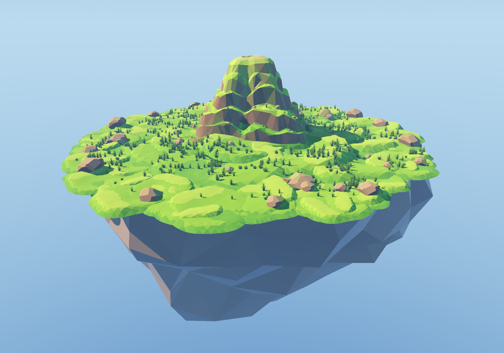
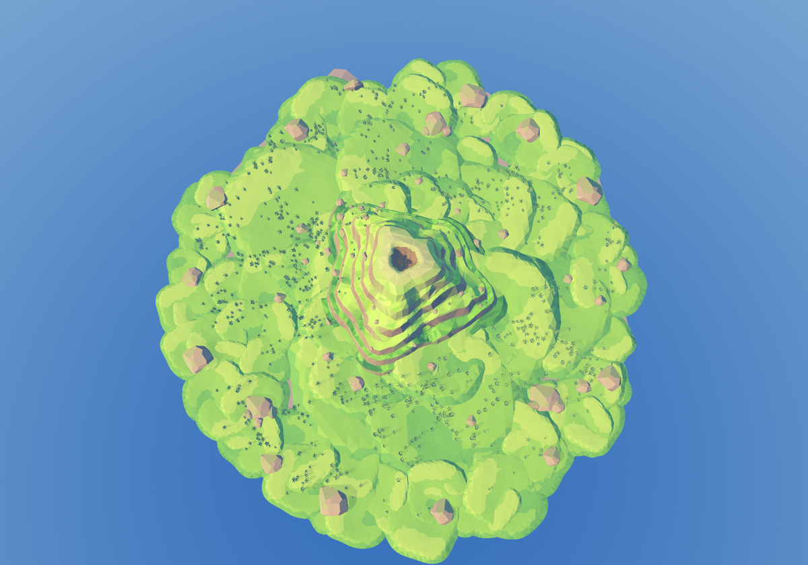
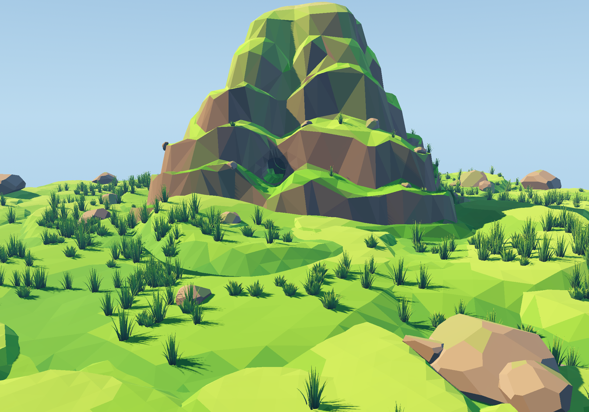
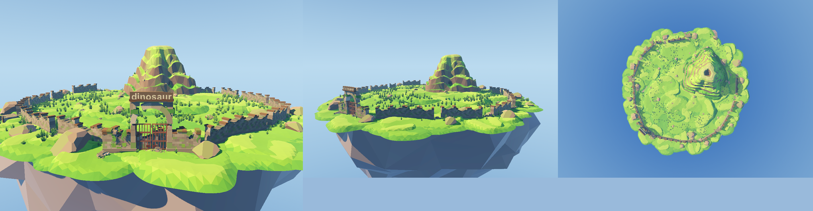

# 低模岛组件

`components/island/island.tscn` — 一座可直接实例化的 low-poly 漂浮岛：
岛北侧一座雪峰低山，绿色草毯覆盖岛面，岛缘和山体上散落着石头，草丛成簇分布。







## 节点结构

```
Island (Node3D, island.gd)
├── WorldEnvironment      程序化天空 + 雾 + Filmic 色调
├── Sun                   主光（带阴影）
├── FillLight             冷色补光（无阴影）
├── BounceLight           从下方来的云海反光（无阴影）
├── PreviewCamera         当前相机，用于单独打开场景时取景
├── IslandBase            sky-island-basic.glb，scale 13，台面刚好落在 y = 0
│   └── SkyIsland
├── Ground                多尺度铺成连续草毯
│   └── Terrain           MultiMeshInstance3D（116 块 plain_terrain 合批）
├── Mountain              low_poly_low_mountain.glb，scale 0.8，偏心摆在岛北侧
│   └── LowMountain
└── Scatter
    ├── Rocks             66 块 low_poly_rock
    │   ├── RimBoulders   岛缘大石
    │   ├── FieldBoulders 草地上的石头与前景石组
    │   ├── MountainFoot  山脚碎石
    │   └── MountainBoulders 山腰坡面上的石头
    └── Grass             922 丛 grass_tuft / grass_clump
        ├── IslandGrass
        └── MountainGrass
```

## 关键尺度

| 元素 | 值 | 说明 |
| --- | --- | --- |
| 岛屿本体 | scale **13** | glb 台面局部高度 0.71 → 缩放后 9.23 m，节点 y = −9.23，台面落到 **y = 0** |
| 岛屿台面 | 半径约 **29.5–34.5 m** | 棕色岩台，外圈只留 1–3 m 薄岩唇，其余用草块和边缘碎块盖住 |
| 山体 | scale **0.80**，yaw −18° | `low_poly_low_mountain.glb`；山脚半径约 **9–17 m**，峰顶约 **17.8 m**；含水下裙边总高约 18.6 m |
| 草地地形块 | 10 m 模型，**五种尺度** | 大块 scale 1.7–2.45 / 中块 1.0–1.6 / 小块 0.55–0.95 / 补缝块 0.7–1.2 / 岛缘碎块 0.55–1.1 |
| 山脚过渡 | 20 块抬升地形 | 只叠在草毯上（不互相堆叠），把山脚埋进缓坡里 |
| 石头 | 2.9 m 模型，scale 0.20–1.7 | 岛缘大石、草地石、山脚碎石、山腰石四档 |
| 草 | 0.41–0.77 m 模型，scale 0.7–1.7 | 约 100 个草簇，岛面 + 山坡 |

所有变换都已烘进 `.tscn`（静态摆放，无运行时随机）。同一份场景每次打开的位置完全一致。

## 四个比例 / 层次问题的处理

1. **山与岛的比例**：岛体从 scale 11 放大到 13（台面直径约 62 m），山体是
   `low_poly_low_mountain.glb`（自带 22.5 m 峰顶的双峰雪锥），场景里按 scale 0.80 摆
   （峰顶约 17.8 m、山脚宽约 26 m），山不再占掉半个岛，草毯和石头有足够的空间。
   换山时**山脚落点要重新对**：新山更陡，同一个高度对应的半径不一样，
   山上的草石得用 `ground_scatter/resnap_scatter.gd` 的 `slide` 模式重贴，
   再重烘 MultiMesh（`bake_scatter.gd`，**不能**加 `--headless`）。
2. **岛缘裸面**：草块分五档尺度铺，外圈再补两圈岛缘碎块；覆盖检测会优先填掉
   绿色草毯里的空洞，最后只剩一圈很薄的棕色岩唇。
3. **地形不机械**：大/中/小/补缝/岛缘五档随机尺寸，高度缩放 0.8–1.8 不等；
   大块负责大起伏，小块负责坡脚和缝隙，不再是一圈同样大的圆垫子。
4. **山脚过渡**：山脚周围 20 块抬升地形是从“纯草毯表面”向上叠的，不会互相堆成
   悬空的绿板；地形先抬到 1–2 m 的缓坡，山体再落进去，所以看不到垂直的墙。

## 光照 / 氛围

- 左前上方暖色主光拉出长阴影，冷色补光把暗面提亮，下方反光模拟云海反射。
- 程序化天空 + 很淡的雾 + Filmic + 饱和度 / 对比度调整，保持 low-poly 的高饱和面感。
- `PreviewCamera` 已设为 current，直接按 F6 就能看到预览图的角度。

## 碰撞

`island.gd` 在 `_ready()` 里补碰撞，分两条路：

- **单网格**（`Mountain`）：每个 `MeshInstance3D` 挂一个 `StaticBody3D +
  CollisionShape3D`（三角面碰撞）。
- **`Ground`**：地形已经合成一个 MultiMesh，不是 `MeshInstance3D`，所以补
  **1 个 `StaticBody3D` + 每个实例一个 `CollisionShape3D`**，所有形状共享同一份
  三角面数据（116 份 → 1 份）。节点树里只有 `Ground/Terrain`，碰撞体是运行时挂在
  它下面的。

草地不参与碰撞。岛屿台面本身由 `sky-island-basic.glb` 里名字带 `-col` 的节点
自带一个碰撞体，不需要脚本再处理。

如果只想要视觉、不想要碰撞，把 `Island.build_collision` 设为 `false` 即可。

## 一个场景，三个开关

`island.tscn` 是**唯一真源**：岛体、地形、山、环境 / 三盏灯 / 预览相机、922 丛草、
66 块石头、沿岛缘的围墙和大门，全都在这一个场景里。

其他场景用三个导出开关按需关掉其中一部分（默认全开，单独打开 `island.tscn` 就是预览图的样子）：

| 开关 | 关掉什么 | 什么时候关 |
| --- | --- | --- |
| `show_presentation` | WorldEnvironment / Sun / FillLight / BounceLight / PreviewCamera | 接进自带环境、灯光和相机的场景（主场景） |
| `show_scatter` | `Scatter`（922 草 + 66 石，62 m 尺度） | 接进大世界，改用大世界自己烘的 `local_scatter.tscn`（720 草 + 180 石） |
| `show_perimeter` | `ParkPerimeter`（围墙 + 大门，62 m 尺度） | 接进大世界，改用 1:1 米制的 `park_entrance_local.tscn` |

三个开关都在 `_enter_tree()` 里生效（不是 `_ready()`）：被隐藏的草石 / 围墙会同时把
子组件的 `build_collision` 关掉，所以隐藏之后**不会留下隐形碰撞体**。这一点很关键——
它们的碰撞是按 62 m 岛尺度补的，乘上主场景的 32 倍会变成几十米宽的隐形石头、
半径近 1 km 的隐形围墙。

主场景 `scenes-3d/jurassic-island/jurassic-island.tscn` 就是这么用的：

- 实例化 `island.tscn`，把三个开关全部设为 `false`；
- 自己实例化烘焙好的 `local_scatter.tscn`（720 草 + 180 石）和 1:1 米制的
  `park_entrance_local.tscn`；
- 主场景本身没有运行时脚本；地形/山体碰撞仍由 `island.gd` 在组件内补齐，
  本地草石碰撞由 `ground_scatter.gd` 运行时补。

之前那份精简副本 `island_terrain.tscn` 已经删掉了：它和 `island.tscn` 会各自漂移
（比如山体的 `transform` 就漏同步过一次），主场景现在直接吃最新版本。
`park_perimeter/bake_perimeter.gd` 烘围墙时也是实例化 `island.tscn` 并关掉这三个开关。

## 园区入口 `ParkPerimeter`

`island.tscn` 里挂了一个 `ParkPerimeter` 节点：**沿岛缘内缩一圈的断续围墙 + 大门**，
围住全岛 **63%**（2192 / 3504 m²），山体偏心坐在里面。

```
ParkPerimeter                   ← 整体可挪动（改半径/跨度要重跑烘焙，见下）
  ├─ Gate                       ← 大门（components/island/park_gate/）
  ├─ Walls/                     ← 40 段残墙（2.9 m/段，长短不一的连续段之间是塌口）
  └─ Debris/                    ← 碎石堆（塌口/门墩/围内散落）+ 4 段倒伏墙
```



### 布局规则

| 项 | 值 | 说明 |
| --- | --- | --- |
| 围墙走向 | **沿岛缘内缩 5 m** | 每个角度射线量岛缘半径（30–36 m），墙不会挂在崖坡上 |
| 覆盖角度 | 门 **±140°** | 背后留 80° 豁口 |
| 围住面积 | **2192 m² = 63%** | 岛面实测 3504 m² |
| 山体偏移 | **13 m**（朝 264°） | 约可用进深的 75%，不再是对称同心圆 |
| 单段墙长 | 2.90 m | 与 `ruined_wall` 资产一致，段内接缝严丝合缝 |
| 连续段长度 | 1–5 段（2.9–14.5 m） | **长短不一**，每段之后必是塌口 |
| 塌口长度 | 1.2–3.6 m | 塌口处丢碎石，部分再倒一段墙 |
| 贴地 | 逐段射线取地面高度 | 相邻 2.9 m 高差 > 0.42 m 就强制断开；外侧 2.5 m 陡降 > 1.2 m 也断开（崖边塌口） |

破败感不是靠贴图，靠三件事：**断续**（长短不一的残段 + 塌口）、**沉降**
（每段独立贴地 + 28% 的段额外下沉，墙头高低不齐）、**碎片**（塌口碎石、倒伏墙、门口撞击堆）。

### 改布局 = 改参数 + 重跑烘焙

场景是**烘出来的静态节点**，不是运行时生成：墙要贴在真实地面高度上，而地面碰撞是
`island.gd` 运行时才补的，编辑器里量不到。所以参数改完要重烘：

```bash
cd /Users/zhouyunge/Documents/godot/open-jurassic-island
/Applications/Godot.app/Contents/MacOS/Godot --path . \
  --script res://components/island/park_perimeter/bake_perimeter.gd -- \
  res://components/island/park_perimeter/park_perimeter.tscn
```

参数都在 `bake_perimeter.gd` 顶部（`RING_R` / `SPAN_DEG` / `RUN_MAX` / `GAP_*` /
`STEP_BREAK` / `SINK_VARIANCE` …），末尾可再传一个随机种子换一套破败分布。
**必须带真实渲染器跑**（不要 `--headless`）：headless 的渲染与物理都是 dummy，
射线打不到地面、实例变换也存不下来。

> ⚠️ **别把 `ParkPerimeter` 挪进 `Island` 节点下面**。主场景 `jurassic-island.tscn` 给
> `Island` 加了 `Transform3D(32.258, 0, 0, 0, 20.9677, 0, 0, 0, 32.258, ...)` ——
> **32 倍、而且 Y 轴非等比**，大门进去会被拉成 340 m 宽的假门楼。
> 要放进主场景，请摆在 `Island` 的**兄弟位置**（1:1 米制）。

## 地形也是 MultiMesh（116 → 1）

`Ground` 原来是 **116 个 `plain_terrain.glb` 实例**：节点 116 个、4 个表面 → 464 个
draw call，`island.gd` 还要给每块单独补一份三角面碰撞。这些地块用的是同一份网格，
只是变换不同，所以合成 **1 个 `MultiMeshInstance3D`**：

| | 原来 | 现在 |
| --- | --- | --- |
| `Ground` 子节点 | 116 | **1**（`Ground/Terrain`） |
| draw call | 464 | **4**（4 个表面各 1 个） |
| 网格内存 | 116 份 | **1 份** |
| 地形碰撞形状 | 116 份（每块一份三角面数据） | **1 份**（116 个形状共享） |

- 摆放数据的源是 `ground/island_ground.json`（116 个 12 float 变换），产物是
  `ground/island_ground.res`（二进制 MultiMesh）。
- 要挪地块：改 JSON → 重烘。**必须带真实渲染器**（不要加 `--headless`）：MultiMesh
  的实例变换存在 RenderingServer 里，headless 的 dummy 渲染器会把它们全丢掉，烘出来的
  是一堆零矩阵。

```bash
cd /Users/zhouyunge/Documents/godot/open-jurassic-island
/Applications/Godot.app/Contents/MacOS/Godot --path . \
  --script res://components/island/ground/bake_ground.gd -- \
  res://components/island/ground/island_ground.json \
  res://components/island/ground/island_ground.res
```

> ⚠️ 同理，`tests/verify_island.gd` 也要带真实渲染器跑 —— headless 下读不到 MultiMesh
> 的实例变换，草石贴地 / 地形碰撞那几项会全错。

## 草石现在是 MultiMesh

`Scatter` 不再是上千个道具节点，而是实例化了
`components/island/ground_scatter/island_scatter.tscn`：

```
Scatter                        ← MultiMesh 散布（17 个节点 / 988 个实例 / 8 个 draw call）
  ├─ Grass
  │   ├─ IslandGrass           ← 分组容器（保留原来的层级语义）
  │   │   ├─ GrassTuft         ← MultiMeshInstance3D（564 实例）
  │   │   └─ GrassClump        ← MultiMeshInstance3D（314 实例）
  │   └─ MountainGrass
  │       ├─ GrassTuft / GrassClump
  ├─ Rocks
  │   ├─ RimBoulders / FieldBoulders / MountainFoot / MountainBoulders
  │       └─ Rock              ← MultiMeshInstance3D
  └─ RockCollision             ← 运行时生成：1 个 StaticBody3D + 66 个共享凸包形状
```

- 草的 MultiMesh 关掉了投影（`cast_shadow = 0`），上千棵草的阴影是纯浪费。
- 石头碰撞由 `ground_scatter.gd` 在运行时补，形状资源共享，所以 66 块石头只占一份形状数据。
- 位置数据的源是 `ground_scatter/island_scatter.json`，改完要重跑
  `bake_scatter.gd`。细节和踩过的坑见 `ground_scatter/README.md`。
- `island.gd` 的 `collision_groups` 里**不再包含** `Scatter/Rocks`：MultiMesh 不是
  `MeshInstance3D`，三角面补碰撞那套扫不到它，石头碰撞改由散布组件自己负责。
