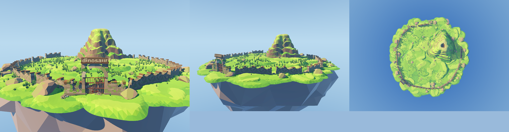

# 环山断续围墙 `ParkPerimeter`

荒废园区的外围：**沿岛缘内缩一圈、围住全岛 63% 面积的断续围墙 + 一座 "dinosaur" 大门**，
墙是断断续续、长短不一的，断口处堆着塌下来的碎石，个别段整片倒伏。山体偏心坐在里面。

两个产物，别混：
| 场景 | 用在哪 | 规模 |
| --- | --- | --- |
| `park_perimeter.tscn` | 展示岛 `components/island/island.tscn` | 沿岛缘一圈，围住 **2192 m² / 63%** |
| `park_entrance_local.tscn` | 主场景 `scenes-3d/jurassic-island/jurassic-island.tscn` | 1:1 的"入口本身"：门 + 两侧各 24 m 残墙 |



## 结构

```
ParkPerimeter
  ├─ Gate                  ← park_gate.tscn（10.56 × 6.24 m，含开合动画）
  ├─ Walls/                ← 18 段 ruined-wall（2.9 m/段）
  └─ Debris/
      ├─ Rubble_xx         ← 塌口处的碎石（1~2 摊/塌口）
      ├─ Fallen_xx         ← 倒伏的整段墙（半埋）
      ├─ InnerDebris_xx    ← 围内散落的碎石
      └─ GateHit_E/W       ← 门墩两侧的撞击堆
```

## 布局规则（对应"被恐龙肆虐过"）

| 项 | 值 |
| --- | --- |
| 围墙走向 | **沿岛缘内缩 5 m**（每个角度射线量岛缘半径），不挂在崖上 |
| 覆盖角度 | 门 **±140°**，背后留 80° 豁口 |
| 围住面积 | **2192 m²**，占岛面 3504 m² 的 **63%** |
| 连续段 | 1–5 段（2.9–14.5 m），段与段之间必是塌口 |
| 塌口 | 1.2–3.6 m |
| 贴地 | 逐段射线取地面高度；相邻段高差 > 0.42 m **强制断开**；外侧 2.5 m 内陡降 > 1.2 m 也断开（崖边塌口） |
| 高低差 | 28% 的墙段额外下沉 0.1–0.55 m，墙头天然高低不齐 |
| 山体偏移 | **12 m**（朝 280°，≈ 可用进深的 75%）→ 不再是同心圆靶子，前后有纵深 |

**为什么不硬接成一条连续曲线**：墙的每一段是直线（段内接缝严丝合缝，108 个剖面点全等），
靠**在塌口处转向**来跟着岛缘走。这样既保住了拼接质量，又天然得到"一段段折断"的废墟感。

**为什么围墙沿岛缘而不是绕山画圆**：山体半径就有 14.5 m、岛面最窄处半径 30 m。
绕山画圆时，半径一旦超过 ~20 m 就会穿出岛外；而"围住 50% 以上（1750 m²）"要求半径 23 m 以上
—— 两者不可兼得。沿岛缘内缩则同时满足：面积够大（63%），山还能偏心摆，
而且"进门 → 穿过空地 → 山在远处"的纵深更自然。

## 重新烘焙

场景是**烘焙出来的静态节点**，不是运行时生成 —— 墙要贴在真实地面高度上，而地面碰撞是
`island.gd` 运行时补的，编辑器里量不到。

```bash
cd /Users/zhouyunge/Documents/godot/open-jurassic-island
/Applications/Godot.app/Contents/MacOS/Godot --path . \
  --script res://components/island/park_perimeter/bake_perimeter.gd -- \
  res://components/island/park_perimeter/park_perimeter.tscn [seed]
```

参数在 `bake_perimeter.gd` 顶部：`RING_R` / `SPAN_DEG` / `GATE_ANGLE_DEG` / `RUN_MAX` /
`GAP_MIN` / `GAP_MAX` / `STEP_BREAK` / `SINK` / `SINK_VARIANCE` / `SINK_EXTRA` /
`FALLEN_CHANCE` / `GATE_RUBBLE` / `RUBBLE_EXTRA`。

### 挪山之后必须重贴地

散点是**烘死的坐标**。山体一挪，原先站在山脚地形上的草石就会悬空、或被山体埋住。
`ground_scatter/resnap_scatter.gd` 负责修：对每个道具从其上方打一条向下的射线，
命中山体就贴山体、命中地面就贴地面，**头顶地面比它还高 0.5 m 以上的直接剔除**（被埋住了）。

```bash
/Applications/Godot.app/Contents/MacOS/Godot --path . \
  --script res://components/island/ground_scatter/resnap_scatter.gd -- \
  components/island/ground_scatter/island_scatter.json '*'
```

再跑 `bake_scatter.gd` 重烘 MultiMesh。**射线必须排除石头自己的碰撞体**，
否则每块石头都会"贴"到自己头顶上、然后被自己的碰撞体判成"被埋"而删掉
（这个坑踩过一次，一次删掉了 49 块石头）。

### 三个坑

1. **必须带真实渲染器**（不要 `--headless`）。headless 的渲染器和物理都是 dummy：
   射线打不到地面（量到的全是 `-INF`），实例变换也存不进 `.res`。
2. **容器节点也要 `owner`**。`PackedScene.pack()` 只保存 `owner == 根` 的节点；
   `Walls` / `Debris` 忘了设 `owner` 时，烘出来的场景里只剩一个大门。
3. **烘之前先让 Godot 导入资产**。新加的 `.glb` 没导入时 `load()` 返回 null，
   脚本会在 `instantiate()` 处报错中断（表现为"只烘了一半"）。

## 验证结果

- 组件自检 `components/island/tests/verify_island.gd`：31 项全过
- 主场景自检 `scenes-3d/jurassic-island/tests/verify_jurassic_island.gd`：41 项全过
- 贴地检查会把 `ParkPerimeter` 的碰撞体排除掉（否则射线打在墙顶，会误判成"草悬空"）
