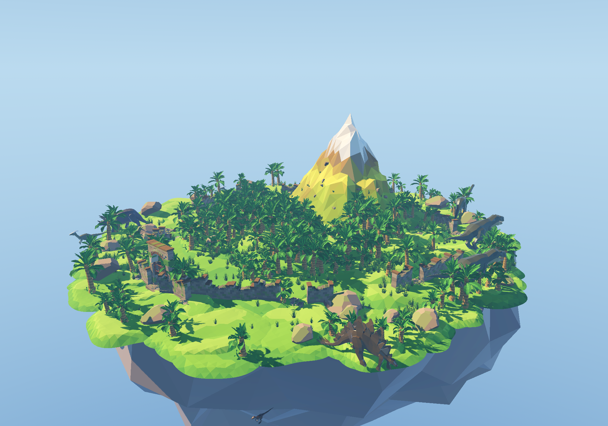
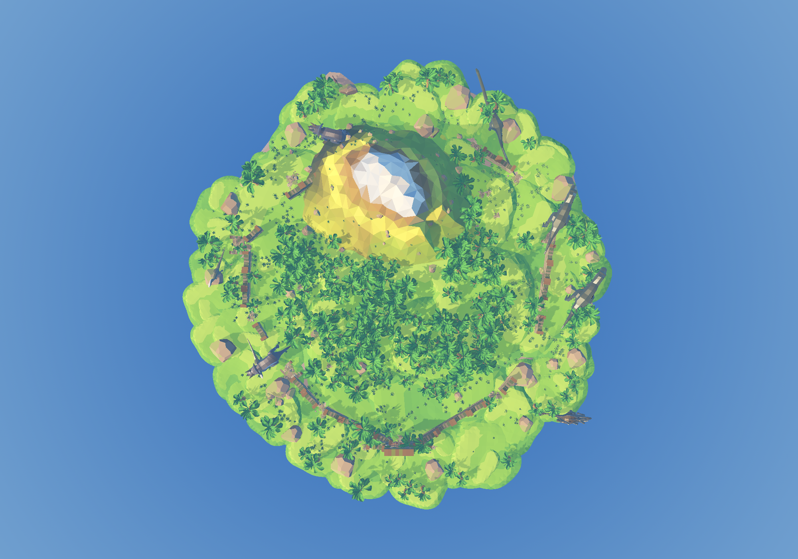

# 岛屿植被 `island_vegetation`

低模岛上的**香蕉树林**（高款 + 矮款），全部**烘死**成静态场景，
由 `components/island/island.tscn` 实例化。

恐龙是**另一个场景文件**（`island_dinosaurs.tscn`）—— 树和恐龙是两回事，
不挤在一起。恐龙本身是独立组件（`components/vegetation/dinosaur/`），
行为在独立 AI 模块（`components/ai/dinosaur/`）；这里只烘它的
**摆放位置**和**巡逻路线**。





## 目录

```
components/island/vegetation/
  bake_vegetation.gd      # 烘焙脚本：噪声采样 → JSON → MultiMesh + 场景
  island_vegetation.json  # 摆放数据的**源**（树 / 恐龙的逐实例变换 + 巡逻路线）
  island_vegetation.tscn  # 烘出来的**树**场景（island.tscn 里实例成 Vegetation）
  island_dinosaurs.tscn   # 烘出来的**恐龙**场景（island.tscn 里实例成 Dinosaurs）
  island_vegetation_*_trees.res   # 烘出来的二进制 MultiMesh（构建产物）
  vegetation.gd           # 运行时脚本：补树干碰撞
  island_vegetation_*.png # 预览图
```

**`.res` 是构建产物，`.json` 才是源。** 改布局就改 JSON（或改脚本参数重跑
`generate`），然后重跑 `bake`。

## 效果

| | 逐棵摆（没做） | 现在 |
| --- | --- | --- |
| `island.tscn` 里的节点数 | 290 棵 + 10 只恐龙 ≈ **300+** | **2 个**（`Vegetation` + `Dinosaurs` 两个实例） |
| 树的 draw call | 290 × 2 表面 ≈ **580** | **4**（2 个 MultiMesh × 2 表面） |
| 树网格内存 | 290 份 | **2 份** |
| 树干碰撞形状 | 每棵一份 | **2 份**（同款式共享） |

## 布局：噪声采样，不是程序化生成

所有位置都是 `bake_vegetation.gd` 用 [FastNoiseLite] 采样出来的，
**烘进 JSON 和 `.res`**，运行时不生成、不随机 —— 每次打开位置完全一致。

### 三个场

| 场 | 频率 | 作用 |
| --- | --- | --- |
| 密度场 | 0.052 | 决定哪里是林子、哪里是空地（空地留给恐龙和玩家） |
| 款式场 | 0.105 | 决定这一棵是高款还是矮款 —— 两种树**成片交错**，不会东一棵高西一棵矮地乱跳 |
| 路面噪声 | 0.052 | 让环岛路的半径有起伏，路的边缘不是一个死板的圆 |

密度阈值**按分位数取**（`FOREST_COVERAGE = 0.92`）：先统计这片岛上噪声值的
分布，取 8% 分位当"林线"，下面的全是空地。这样不管岛的大小、噪声的分布
怎么变，"岛上有多大比例是林子"都是可控的。

### 道路

| 道路 | 位置 | 半宽 |
| --- | --- | --- |
| 环岛路 | 岛缘内缩 **11 m**，跟着岛缘的形状走 | 1.8 m |
| 支路 ×3 | 104° / 232° / 318° 三个方向伸向岛心 | 1.6 m |

路面上**不长树**（外加一点随机余量，路缘才不是一把尺子切出来的）。
冒险者顺着路跑、恐龙也能沿着路巡逻；林子里的树则是现成的掩体 ——
树干有碰撞，玩家可以贴着树躲开恐龙的视野。

### 其它约束

| 约束 | 值 | 为什么 |
| --- | --- | --- |
| 离岛缘 | ≥ 2.0 m | 树不长在崖边 |
| 离围墙 | ≥ 1.4 m | 别让树从残墙里长出来（围墙在岛缘内缩 5 m） |
| 坡度 | ≤ 1.0 m/m | 太陡的地方不种树 |
| 雪线 | ≤ 5.0 m | 山顶保持裸岩 |
| 树间距 | ≥ 1.15 m | 两棵不叠在一起 |
| 恐龙周围 | 半个体长 × 0.45 + 1.2 m | 别把树种在恐龙身上 |
| 石头周围 | 石头半径 + 0.8 m | 别让树从石头里长出来 |

## 恐龙

恐龙是**独立组件**：`components/vegetation/dinosaur/`。
**每种恐龙一个自己的 `.tscn`**（模型、体型、胶囊、速度都在场景里），
巡逻逻辑共用一份 `dinosaur.gd`。

| 名字 | 场景 | 体长 | 数量 |
| --- | --- | --- | --- |
| T-Rex | `t_rex.tscn` | 11 m | 2 |
| Triceratops | `triceratops.tscn` | 8 m | 2 |
| Stegosaurus | `stegosaurus.tscn` | 8.5 m | 1 |
| Parasaurolophus | `parasaurolophus.tscn` | 6 m | 2 |
| Velociraptor | `velociraptor.tscn` | 2.2 m | 2 |
| Apatosaurus | `apatosaurus.tscn` | 17 m | 1 |

恐龙的**节点不在 `island_vegetation.tscn` 里** —— 它们在单独一个场景
`island_dinosaurs.tscn`（树和恐龙不耦合），由 `island.tscn` 直接实例化。

这里只负责**摆在哪、沿哪条路巡**；体型和巡逻行为都是组件自己的事，
细节见 `components/vegetation/dinosaur/README.md` 和
`components/ai/dinosaur/README.md`。

### 巡逻路线也是烘的

路线 = **环岛小路绕一圈**，中途有一处往香蕉林里凹进去（恐龙会一头扎进
林子巡一圈再回到路上）。凹进去的位置和深度每只都不一样，所以几只恐龙
不会挤在同一个地方。路点的高度限制在 2.2 m 以下，恐龙不会爬到半山腰。

恐龙**先于树**确定位置：种树的时候会把恐龙身边的树让开。

## 碰撞

MultiMesh 本身不产生碰撞，所以树干碰撞在**运行时**补
（`vegetation.gd`）：

- 1 个 [StaticBody3D] + 每棵树 1 个 [CollisionShape3D]；
- 矮款 / 高款**各共享一份** [CylinderShape3D]（290 棵树只占 2 份形状数据）；
- 形状的变换 = 实例变换再往上抬半个树干高度，所以树怎么缩放、怎么歪，
  碰撞都跟着走。

树干在**植被层**，恐龙**不撞树**（掩码里没有植被层），所以恐龙能在林子里
巡逻、不会被树干挡住；玩家照旧撞得到树。

## 重新烘焙

> ⚠️ **必须带真实渲染器，不要加 `--headless`**：MultiMesh 的实例变换存在
> RenderingServer 里，headless 的 dummy 渲染器会把它们全丢掉，烘出来是一堆
> 零矩阵（加载时物理直接报 `det == 0`）。和 `ground_scatter/bake_scatter.gd`、
> `ground/bake_ground.gd` 是同一个坑。

```bash
cd /Users/zhouyunge/Documents/godot/open-jurassic-island

# 重新采样布局（噪声）+ 重新烘 .res / .tscn
HOME="$PWD/.godot_home" /Applications/Godot.app/Contents/MacOS/Godot --path . \
  --script res://components/island/vegetation/bake_vegetation.gd -- all

# 只按现有 JSON 重新烘 .res / .tscn（手改过 JSON 之后跑这个）
HOME="$PWD/.godot_home" /Applications/Godot.app/Contents/MacOS/Godot --path . \
  --script res://components/island/vegetation/bake_vegetation.gd -- bake

# 换一套布局（换种子）
... -- all 20260715
```

`HOME="$PWD/.godot_home"` 是这个项目的惯例：把 Godot 的用户目录放进项目里，
免得日志 / 缓存写到用户主目录去。

## 三个必须知道的坑

1. **要等物理帧，不是等渲染帧。**
   `island.gd` 在 `_ready()` 里给草地 / 山体补碰撞（地形的 116 块碰撞体 + 山体），
   碰撞体要等物理服务器真正吃进去才存在。启动阶段一帧渲染可能顶好几帧物理，
   只数渲染帧的话射线会打在还没同步好的地形上，量出来的地面高度偏低 ——
   **同一份脚本跑两次结果能差 50 棵树**。
   光等帧数还不够：地形是 116 块共享同一份三角面的碰撞体，物理服务器第一次
   查询时还在建 BVH，早到的射线会漏掉一部分地形（实测同样等 240 帧，脚本改过
   之后第一次跑还是会差 50 棵树）。所以脚本在等够物理帧之后还会打一轮
   **收敛检查**：同一批探针连续两轮量出来的地面高度完全一样，才算稳定
   （[method _physics_settled]）。

2. **树和恐龙的随机是"位置哈希"，不是随机数流。**
   抖动、抽签都用 `hash(格子坐标)` 算，所以同一个格子永远得到同一个结果。
   改一个参数不会把整片林子重新洗牌，树的棵数也稳定可预期
   （用随机数流的话，改一个阈值会让整棵树的位置全变）。

3. **烘的时候要把草石和围墙关掉。**
   `bake_vegetation.gd` 实例化 `island.tscn` 时把 `show_scatter` /
   `show_perimeter` / `show_presentation` 都设成 `false`：石头和残墙也有碰撞体，
   射线打在它们上面会量错地面高度。

## 验证

```bash
HOME="$PWD/.godot_home" /Applications/Godot.app/Contents/MacOS/Godot --path . \
  --script res://components/island/tests/verify_island.gd
```

`verify_island.gd` 的"香蕉树林 / 恐龙"一节会检查：树走 MultiMesh（不是几百个
节点）、树够多、高矮比例在 30%~70% 之间、树贴地、林子够密**同时**留得出
空地（道路）、树干碰撞补齐且按款式共享形状、恐龙够多且脚底贴地。

> 同样**不能加 `--headless`**：树和地形都是 MultiMesh，headless 下读不到实例
> 变换，贴地和密度那几项会全错。

## 接进大世界

`island.tscn` 是按 **62 m** 岛尺度烘的。主场景 `jurassic-island.tscn` 把
`Island` 节点放大 **32 倍**，所以要把它关掉：

```gdscript
[node name="Island" parent="Island" instance=ExtResource("2_island")]
show_vegetation = false   # 4.8 m 的香蕉树放大 32 倍会变成 150 m 高的巨树
```

2000 m 的大世界要自己烘一份 1:1 米制的植被（像 `local_scatter.tscn` 那样），
或者用更稀疏的树 + LOD —— 290 棵 × 2 万棵的顶点数在大世界里是扛不住的。
