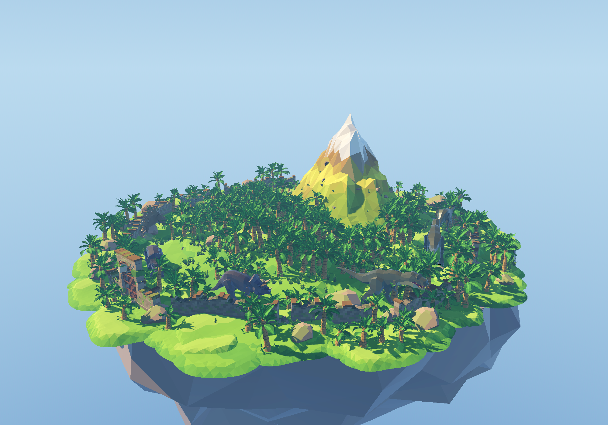

# 恐龙组件 `dinosaur`

恐龙的**身体 + 模型**：**每种恐龙一个自己的场景**，行为全交给
[AI 模块](../../ai/dinosaur/README.md)。



## 目录

```
components/vegetation/dinosaur/
  dinosaur.gd         # 具体的恐龙：找模型、把模型摆正（class_name Dinosaur）
  t_rex.tscn          # 霸王龙
  triceratops.tscn    # 三角龙
  stegosaurus.tscn    # 剑龙
  parasaurolophus.tscn   # 副栉龙
  velociraptor.tscn   # 迅猛龙
  apatosaurus.tscn    # 蜥脚龙
```

## 场景里有什么

```
TRex (CharacterBody3D, dinosaur.gd)
  ├── Collision (CollisionShape3D)  ← 胶囊，底面对齐脚底
  ├── Model (T-Rex.glb)              ← 缩放写死在场景里，缩到真实体长
  └── AI (Node, dinosaur_ai.gd)      ← 感官 + 决策 + 转向，全在 AI 模块里
        config = DinosaurAIConfig_t_rex   ← 每种恐龙的性格（内嵌子资源）
```

| 场景 | 体长 | 缩放 | 胶囊 r×h | 速度 | 转向 | 性格（看多远 / 记多久 / 伤害） |
| --- | --- | --- | --- | --- | --- | --- |
| `t_rex.tscn` | 11 m | 0.35778 | 1.10×4.40 | 2.6 m/s | 40°/s | 24 m / 8 s / 24 |
| `triceratops.tscn` | 8 m | 0.41163 | 0.90×3.30 | 1.8 m/s | 35°/s | 18 m / 6 s / 14 |
| `stegosaurus.tscn` | 8.5 m | 0.39793 | 0.85×3.20 | 1.6 m/s | 30°/s | 16 m / 6 s / 11 |
| `parasaurolophus.tscn` | 6 m | 0.50768 | 0.45×2.40 | 3.2 m/s | 60°/s | 22 m / 7 s / 9 |
| `velociraptor.tscn` | 2.2 m | 0.17387 | 0.22×0.80 | 4.0 m/s | 90°/s | 20 m / 9 s / 7 |
| `apatosaurus.tscn` | 17 m | 0.35157 | 0.90×4.40 | 1.5 m/s | 25°/s | 16 m / 5 s / 18 |

完整的调参表见 [AI 模块的 README](../../ai/dinosaur/README.md)。

## 模型要转 180°

这批 glb 的模型是**朝 +Z** 的（吻在 +Z），而 Godot 的"前方"是 **-Z**
（`look_at`、`-basis.z` 都按 -Z 算）。不转过来的话恐龙就是**倒着走**的。

`dinosaur.gd` 在 `_ready()` 里统一转：

```gdscript
@export var model_yaw_correction_deg: float = 180.0
```

## 缩放是怎么来的

这批 glb 的原生尺寸**不是米制**（霸王龙原生 30.75 m 长、蜥脚龙 48.36 m），
而且网格是**绑定姿态**（顶点还趴着），直接量顶点包围盒会量出又长又歪的结果
（三角龙横躺着 25 m）。

所以体型是**用骨架量**的：吻尖（`Head_end` 骨骼附着点）到尾尖（`Tail5_end`）
的距离 = 体长，除以目标体长就是缩放；所有骨骼 + 脚尖的最低点 = 脚底
（这几款模型脚底正好在 y = 0，所以模型不需要额外偏移）。

## 行为在 AI 模块

巡逻、追击、逃跑、攻击、感官、群体行为全在
[`components/ai/dinosaur/`](../../ai/dinosaur/README.md)：感知 → 黑板 → 决策 →
转向 → 身体。这个组件只负责"身体 + 模型"。

## 在低模岛上的用法

`components/island/vegetation/island_dinosaurs.tscn` 里实例了 10 只
（霸王龙 2、三角龙 2、剑龙 1、副栉龙 2、迅猛龙 2、蜥脚龙 1），
每只带一条烘好的巡逻路线。

**恐龙的节点不在 `island_vegetation.tscn` 里** —— 树和恐龙是两回事，
各自一个场景文件：

```
island.tscn
  ├── Vegetation   → island_vegetation.tscn   （只有香蕉树林）
  └── Dinosaurs    → island_dinosaurs.tscn    （只有恐龙）
```

路线 = **环岛小路绕一圈**，中途有一处往香蕉林里凹进去 —— 恐龙会一头扎进
林子巡一圈再回到路上。凹进去的位置和深度每只都不一样，所以几只恐龙不会
挤在同一个地方。路点的高度限制在 2.2 m 以下，恐龙不会爬到半山腰。

烘焙命令：

```bash
cd /Users/zhouyunge/Documents/godot/open-jurassic-island
HOME="$PWD/.godot_home" /Applications/Godot.app/Contents/MacOS/Godot --path . \
  --script res://components/island/vegetation/bake_vegetation.gd -- all
```

> ⚠️ **必须带真实渲染器，不要加 `--headless`**（MultiMesh 的实例变换存在
> RenderingServer 里，headless 的 dummy 渲染器会全丢掉）。

## 自检

`components/island/tests/verify_island.gd` 会检查：

- 每只恐龙的碰撞掩码**不含**植被 / 建筑 / 杂物层（含了就报警）；
- 每只恐龙都有 AI、有调参表、有 ≥ 8 个路点的巡逻路线；
- **模型的吻在局部 -Z**（防止"倒着走"这个 bug 再犯）；
- 恐龙脚底贴地（用骨架最低点跟地面高度比）；
- 跑 2 秒物理之后**每只恐龙都真的动过**（不是站桩）；
- **树能挡住视线**（玩家躲在树后不会被直接看见）。

同样**不能加 `--headless`**（树和地形都是 MultiMesh）。
