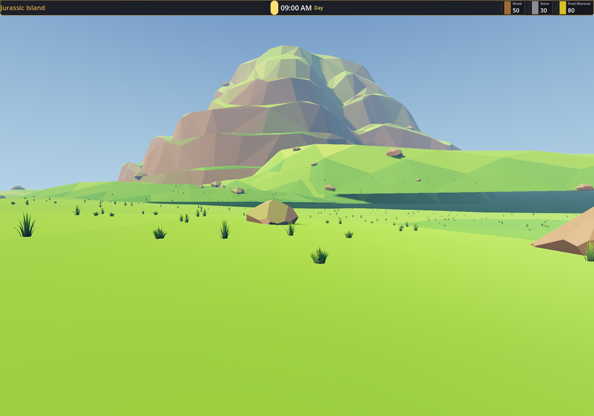
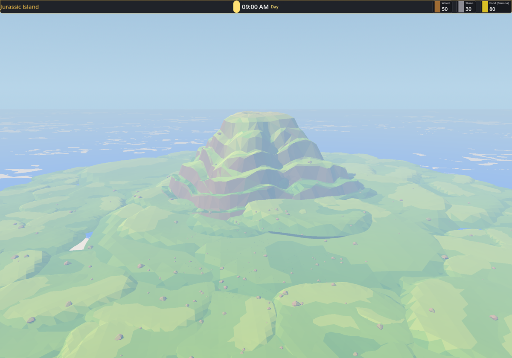

# Jurassic-island 主场景（2000 m，静态配置）





主场景**没有运行时脚本**。2000 m 岛体、12 km 海、玩家出生点、静态草石、灯光/环境
全部写在 `.tscn` / 子场景里，打开编辑器就是最终状态。

## 场景组成

| 部分 | 实现 |
| --- | --- |
| 岛 | `components/island/island.tscn`（组件本体，唯一真源）；`Island` 节点水平 scale **32.258**（62 m 组件 → 2000 m），竖直 scale **20.968**（水平的 0.65） |
| 海 | `components/sea/sea.tscn`，PlaneMesh **12000 × 12000**，关闭阴影投射 |
| 玩家 | `scenes-3d/player/player.tscn`，静态出生点 `(0, 9.7, 55)`；相机 `current = true`、`far = 12000` |
| 园区入口 | `ParkEntrance`（实例化 `components/island/park_perimeter/park_entrance_local.tscn`）：大门 **6.3 × 3.7 m**（原模型 10.56 × 6.24 m，缩到 **60%** —— 对 1.5 m 的玩家来说，原尺寸是四层楼高的门框）+ 两侧各 24 m 断续残墙（墙高 2.25 m）+ 塌口碎石，按 **1:1 米制**摆在出生点前方 12 m。**不能塞进 `Island` 节点**——那里是 32 倍非等比缩放 |
| 本地草石 | `scenes-3d/jurassic-island/local_scatter.tscn`：**12000 丛草 + 6000 草簇 + 180 块石头**的 **MultiMesh**（3 个 MultiMeshInstance3D = 3 个 draw call）；**草撒满全岛**（1:1 米制，约 0.4–0.8 m 高），石头撒在全岛；石头碰撞由 `ground_scatter.gd` 在运行时补：1 个 StaticBody3D + 180 个**共享同一个凸包形状**的 CollisionShape3D |
| **世界植被** | `scenes-3d/jurassic-island/world_vegetation.tscn`：5715 棵香蕉树（1.45 倍大，林子覆盖 45%）（**1:1 米制**：矮 2.66 m / 高 4.77 m），2 个 MultiMesh = 2 个 draw call；用的是**减面版树模**（491 / 571 面，原版 2625 / 3072 面）；树干碰撞用物理服务器直接挂（几千个 CollisionShape3D 节点太重）。树**不投影** |
| **世界恐龙** | `Dinosaurs`（`components/dinosaurs/dinosaurs.tscn`）：**运行时**按 `initial_count` 放 100 只，每只自己算领地（半径 57~106 m）；另加岛缘一圈隐形围栏（只挡恐龙）。**不再有烘焙的 `world_dinosaurs.tscn`** |
| 环境 / 灯光 | **Sky3D**（`addons/sky_3d/`）：`WorldEnvironment` + `SunLight` + `MoonLight` + `SkyDome` + `TimeOfDay` 五个节点，自带大气散射 / 卷云 / 积云 / 星空 / 日月；Godot 深度雾密度 **0.0005**（Sky3D 自己的屏幕空间大气雾关掉，避免和深度雾叠加） |
| **日月循环** | `TimeOfDay.minutes_per_day = **24**` —— **1 游戏分钟 = 1 现实分钟**（Warcraft III 默认：24 游戏小时 = 24 现实分钟），开局 **00:00**。顶栏时钟由 `TimeOfDay.time_changed` 驱动（不是自己走），所以 HUD 上的时间和天上的太阳**永远不会走偏** |

## 为什么之前第一人称玩家“看不见”

展示版 `components/island/island.tscn` 自带一个 `PreviewCamera`（`current = true`）、
一套 WorldEnvironment 和三盏灯。放大后直接放进主场景时：

- 预览相机会抢走第一人称视角；
- 两套环境光/太阳叠加，画面过曝；
- 组件里按 62 m 场景做的草石乘 32 倍后，会变成二十多米高的巨草、几十米宽的巨石。

现在的做法是 **直接实例化组件本体 `island.tscn`**，把它的展示开关关掉：

```
[ext_resource ... path="res://components/island/island.tscn" id="2_island"]

[node name="IslandComponent" parent="Island" instance=ExtResource("2_island")]
show_presentation = false   # 不要组件自带的环境 / 三盏灯 / 预览相机
show_scatter = false        # 不要 62 m 尺度的 922 草 + 66 石
show_perimeter = false      # 不要 62 m 尺度的围墙 + 大门
show_vegetation = false     # 不要 62 m 尺度的 327 棵香蕉树
show_dinosaurs = false      # 不要 62 m 尺度的 10 只恐龙
```

隐藏的同时，`island.gd` 会把被隐藏的草石 / 围墙 / 植被的 `build_collision` 一起关掉
（在 `_enter_tree()` 里，早于子节点 `_ready()`），所以不会留下隐形碰撞体。
主场景自己的相机、灯光、静态草石、1:1 米制的 `ParkEntrance` 接管画面。

> ⚠️ 组件里的香蕉树 / 恐龙是按 **62 m 岛尺度**烘的（树 4.77 m、霸王龙 11 m），
> 乘上 32 倍会变成 150 m 高的巨树、350 m 长的霸王龙 —— 所以
> `show_vegetation` / `show_dinosaurs` 必须关。
>
> 2000 m 的大世界有**自己烘的一份**（1:1 米制）：
> `scenes-3d/jurassic-island/bake_world_vegetation.gd`。
> 树也是 1:1（矮 2.66 / 高 4.77 m）—— 对 1.5 m 眼高的玩家来说是
> 1.8~3.2 倍高，正好是正常的树；恐龙保持真实体型
> （11 m 的霸王龙配 1.5 m 的玩家 = 7.3 倍身高）。
>
> ```bash
> godot --path . --script res://scenes-3d/jurassic-island/bake_world_vegetation.gd
> ```
>
> > 组件里的恐龙只是**藏起来**了，碰撞体还在、AI 还在跑 ——
> > 接进 32 倍的主场景后就是一群看不见的 350 m 巨兽在岛上巡逻，
> > 玩家会撞上一堵"空气墙"。`island.gd` 现在会把它们的碰撞层清零、
> > 关掉 `process_mode`。

这样主场景永远吃的是最新版组件，不会像以前的 `island_terrain.tscn` 副本那样各改各的
（那份副本就漏同步过山体的 `transform`，已经删除）。

## 静态配置细节

1. **岛体**：`Island` 节点的 `Transform3D` 直接写着 2000 m 的缩放和 `y = -0.5`；
   `island.tscn` 里只有一份岛体（台面自带碰撞）、山。
2. **玩家**：`Player` 节点在 `(0, 34, 77.85)`，落在地面约 `31.9`，面朝岛心山体。
   相机 `current = true`、`far = 12000` 写在 `player.tscn`；可站立坡度
   `max_floor_angle_deg = 50` 写在 `player.gd`。
3. **本地草石**：`local_scatter.tscn` 是烘焙好的静态场景，720 草 + 180 石；
   草铺在**出生点周围 180 m**（1:1 米制），石头撒在全岛；
   每块石头的 `CollisionShape3D` 共用同一个 `ConcavePolygonShape3D` 资源。
4. **海 / 视野**：12000 m 海面 + 12000 m 相机远裁剪 + 0.0005 雾密度，
   约 6 km 外基本全雾，海面边缘不可见。
5. **岛组件碰撞**：`island.tscn` 挂着 `components/island/island.gd`，由组件自己在运行时
   给 `Ground` / `Mountain` 补三角面碰撞（这是组件级行为，主场景本身没有脚本）。
   本地草石的视觉是 MultiMesh（不是上千个节点）；石头碰撞由 `ground_scatter.gd` 运行时补，
   形状资源共享，所以 180 块石头只占一份形状数据。
6. **日月循环（Sky3D）**：主场景里没有运行时脚本，时间由 `Sky3D/TimeOfDay` 节点自己走。
   - `minutes_per_day = 24` = **24 现实分钟一天**（Warcraft III 默认：1 游戏分钟 = 1 现实分钟）。
   - 开局 `current_time = 0.0`（**午夜**，也是 WC3 地图的默认开局时间）。
   - `update_interval = 0.1`（10 Hz）：24 分钟一天不需要 60 Hz，省 CPU。
     插件文档说「短于 15 分钟才需要 0.016」。
   - `SkyDome.fog_visible = false`：Sky3D 的**屏幕空间**大气雾关掉，只留 Godot 自带的
     深度雾（0.0005），否则两层雾叠在一起，远景会糊成一片。
   - 原来的 `FillLight` / `BounceLight`（固定方向的补光）**删掉了** —— 它们方向不变，
     夜里会露出一盏「不动的太阳」。现在夜里的亮度由 `MoonLight` + 环境光
     （`night_sky_contribution = 0.35`，夜间天空贡献自动降低）负责。
   - 顶栏时钟：`TopBar.auto_advance_time = false`，改由
     `TimeOfDay.time_changed` → `TopBar.set_time_of_day()` 驱动（信号连在 `.tscn` 里）。
     **顶栏自己不再走表**，所以 HUD 和天空永远不会走偏。

### 想改周期长度？

| 要改的 | 改哪 |
| --- | --- |
| 一天多长 | `Sky3D/TimeOfDay.minutes_per_day`（**24 = WC3 默认**）+ `Sky3D.minutes_per_day`，两边要一致 |
| 主菜单的时钟 | `scenes/menus/main_menu/main_menu.tscn` 的 `TopBar.day_length_seconds`（自己走表，秒/天） |
| 开局几点 | `TimeOfDay.current_time` + `Sky3D.current_time`（都是 0.0 = 午夜） |

> 主菜单的顶栏是**另一份实例**，它自己按 `day_length_seconds = 1440` 走表（同样是 24 分钟一天）。
> 进入主场景时时钟会**重置回 00:00**（主场景从自己的午夜开始）。

## 碰撞层

主场景里所有东西都靠 5 个 3D 碰撞层分家（`project.godot` 的 `layer_names`）：

| 层 | 名字 | 谁在上面 | 玩家撞吗 | 恐龙撞吗 |
| --- | --- | --- | --- | --- |
| 1 | world | 地形、山体、岛体 | ✅ | ✅ |
| 2 | vegetation | 香蕉树的树干 | ✅ | ✅ |
| 3 | structure | 园区围墙、大门 | ✅ | ✅ |
| 4 | prop | 石头、碎石 | ✅ | ❌ |
| 5 | creature | 玩家、恐龙 | — | ✅ |
| 6 | boundary | 岛缘的隐形围栏 | ❌ | ✅ |

> 大世界的树 / 恐龙是**单独烘**的，不在组件里：组件那份是 62 m 尺度的。

玩家（`collision_layer = 16`、`collision_mask = 31`）照旧什么都撞得到；
恐龙勾 **world + vegetation + structure + creature + boundary**，**不勾 prop** ——
树、墙挡得住它（恐龙是实心的），石头挡不住（石头最高 5 m，跨得过去）。
**视线**照样被树挡住，所以玩家能躲树
（见 `components/ai/dinosaur/README.md`）。

## 关键比例

| 项目 | 值 |
| --- | --- |
| 岛体 footprint | 1414 m × 1414 m（2026-11 面积减半） |
| 山 | 约 **266 m** 高（`low_poly_low_mountain` 组件内 18 m × 14.826），在出生点西北约 250 m |
| 海面 | 12000 m × 12000 m（岛外半径 5000 m） |
| 相机远裁剪 | 12000 m |
| 雾密度 | 0.0005 |
| 玩家出生 | `(0, 9.7, 55)`，面朝岛心（大门正前方 12 m）；**眼高 1.5 m** |
| 基础地形最大坡度 | 网格抽查约 1850 点，最大 **0°**（台面是平的，只有山体有坡）；玩家可站立 50°，不用跳 |

## 岛面：岩台 + 绿地表层

2026-11 起，岛面分两层：

| 层 | 是什么 | 高度（世界坐标） |
| --- | --- | --- |
| 岩台 | 岛体（`sky-island-basic.glb`）自带的平顶岩盘（半径 29.25–34.5 m，组件坐标） | **8.26 m** |

树 / 草 / 石 / 恐龙 / 玩家都直接站在**岩台**上。

> 2026-11：世界原先还盖着一层自己烘的**绿色地表层**（`WorldGround`，
> 709 块放大压扁的 `plain_terrain`，比岩台高 0.5 m）。它跟岩台只差半米，
> 却多一层碰撞 + 一层绘制，已经删掉了 —— 地面就是岩台。

原先岛面上盖着一层**烘出来的草毯**（组件里的 `Ground/Terrain`），它比岩台大一圈
（最外沿 r ≈ 36.7 m），草毯外圈那圈树和石头有一半悬在岛外 —— 那层草毯已经从
组件里删掉了，改成世界在自己的尺度上铺一层绿（组件保持干净）。

> 树 / 草石 / 入口都要贴着**岩台**烘，所以改地形之后按 树 → 草石 → 入口 的顺序重跑。

## 烘焙

大世界的植被、恐龙、入口、草石**都是烘出来的**（`.json` 是源，`.res` / `.tscn` 是产物）：

```bash
# 植被 + 恐龙（大世界）
godot --path . --script res://scenes-3d/jurassic-island/bake_world_vegetation.gd

# 出生点附近的本地草石
godot --path . --script res://scenes-3d/jurassic-island/bake_local_grass_cli.gd

# 1:1 米制的园区入口（大门 + 残墙 + 碎石）
godot --path . --script res://components/island/park_perimeter/bake_entrance_local.gd
```

> ⚠️ **必须带真实渲染器，不要加 `--headless`**：MultiMesh 的实例变换存在
> RenderingServer 里，headless 的 dummy 渲染器会全丢掉。
>
> 烘焙脚本都要**等物理服务器收敛**（同一批探针连续两轮量出来的地面高度一样）
> 才动手 —— 地形碰撞是运行时补的，早到的射线会漏掉一部分地形，
> 量出来的地面高度能差 10 m（实测大门直接埋进地里）。

## 自检

```bash
/Applications/Godot.app/Contents/MacOS/Godot \
  --script res://scenes-3d/jurassic-island/tests/verify_jurassic_island.gd
```

50 项检查：主场景无脚本、岛体实例是真正的 `island.tscn`、三个展示开关关闭且没有残留的
隐形碰撞、2000 m 岛体比例、海面尺寸、玩家出生 / 相机 / 站在地面、静态草石数量与碰撞、
基础地形坡度 ≤ 50°、环境与太阳设置。全部通过时退出码为 0。

> ⚠️ 别加 `--headless`：地形是 MultiMesh，headless 下读不到实例变换，地形碰撞会全叠在
> 岛心，坡度那几项就失去意义了。

## 后续

- 海面是单张 12000 m 平面，UV 波纹在大尺度下会被拉伸；后续可以给
  `ocean_visual_shader.tres` 加 UV scale，或换成远/近两层海。
- 当前玩家没有水中物理；走到海里会直接往下掉。后续加水体碰撞/游泳即可。
- 静态草石已经是 `MultiMeshInstance3D`：**4 个节点、900 个实例、3 个 draw call**。
  草的两个 MultiMesh 关掉了投影（`cast_shadow = 0`）——上千棵草的阴影是纯浪费。
  位置数据的源是 `local_scatter.json`，改完要重跑 `ground_scatter/bake_scatter.gd`。
