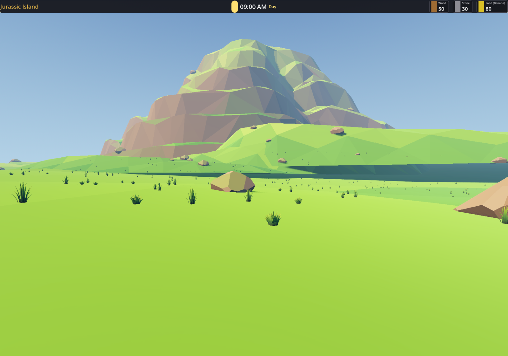
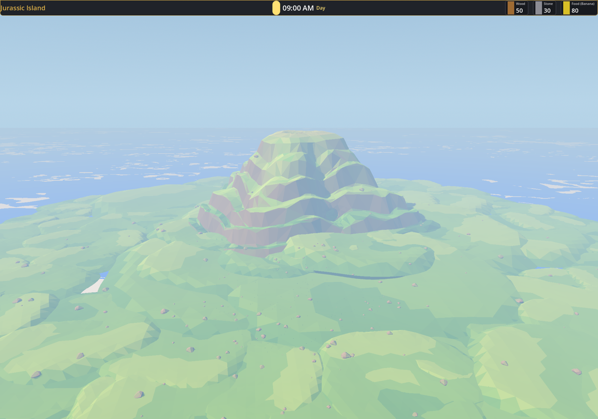

# Jurassic-island 主场景（2000 m，静态配置）





主场景**没有运行时脚本**。2000 m 岛体、12 km 海、玩家出生点、静态草石、灯光/环境
全部写在 `.tscn` / 子场景里，打开编辑器就是最终状态。

## 场景组成

| 部分 | 实现 |
| --- | --- |
| 岛 | `components/island/island.tscn`（组件本体，唯一真源）；`Island` 节点水平 scale **32.258**（62 m 组件 → 2000 m），竖直 scale **20.968**（水平的 0.65） |
| 海 | `components/sea/sea.tscn`，PlaneMesh **12000 × 12000**，关闭阴影投射 |
| 玩家 | `scenes-3d/player/player.tscn`，静态出生点 `(0, 34, 77.85)`；相机 `current = true`、`far = 12000` |
| 园区入口 | `ParkEntrance`（实例化 `components/island/park_perimeter/park_entrance_local.tscn`）：大门 **10.56 × 6.24 m** + 两侧各 24 m 断续残墙 + 塌口碎石，按 **1:1 米制**摆在出生点前方 12 m（门心 `(0, 32.2, 66)`，面朝 +Z 冲着玩家）。**不能塞进 `Island` 节点**——那里是 32 倍非等比缩放 |
| 本地草石 | `scenes-3d/jurassic-island/local_scatter.tscn`：720 丛草 + 180 块石头的 **MultiMesh**（3 个 MultiMeshInstance3D = 3 个 draw call）；石头碰撞由 `ground_scatter.gd` 在运行时补：1 个 StaticBody3D + 180 个**共享同一个凸包形状**的 CollisionShape3D |
| 环境 / 灯光 | 主场景自己的 WorldEnvironment + Sun + FillLight + BounceLight，雾密度 **0.0005** |

## 为什么之前第一人称玩家“看不见”

展示版 `components/island/island.tscn` 自带一个 `PreviewCamera`（`current = true`）、
一套 WorldEnvironment 和三盏灯。放大后直接放进主场景时：

- 预览相机会抢走第一人称视角；
- 两套环境光/太阳叠加，画面过曝；
- 组件里按 62 m 场景做的草石乘 32 倍后，会变成二十多米高的巨草、几十米宽的巨石。

现在的做法是 **直接实例化组件本体 `island.tscn`**，把它的展示开关关掉：

```
[ext_resource ... path="res://components/island/island.tscn" id="2_island"]

[node name="IslandComponent" parent="Island" instance=ExtResource("2_island")]
show_presentation = false   # 不要组件自带的环境 / 三盏灯 / 预览相机
show_scatter = false        # 不要 62 m 尺度的 922 草 + 66 石
show_perimeter = false      # 不要 62 m 尺度的围墙 + 大门
show_vegetation = false     # 不要 62 m 尺度的 290 棵香蕉树
show_dinosaurs = false      # 不要 62 m 尺度的 10 只恐龙
```

隐藏的同时，`island.gd` 会把被隐藏的草石 / 围墙 / 植被的 `build_collision` 一起关掉
（在 `_enter_tree()` 里，早于子节点 `_ready()`），所以不会留下隐形碰撞体。
主场景自己的相机、灯光、静态草石、1:1 米制的 `ParkEntrance` 接管画面。

> ⚠️ `show_vegetation` / `show_dinosaurs` 是**必须**关的：组件里的香蕉树是按
> 62 m 岛尺度烘的（4.77 m 高），乘上 32 倍会变成 150 m 高的巨树，树干碰撞也会
> 变成 10 m 粗的柱子；恐龙更夸张，11 m 的霸王龙会变成 350 m 长。
> 2000 m 的大世界要自己烘一份 1:1 米制的植被和恐龙，或者用更稀疏的树 + LOD ——
> 290 棵 × 2 万棵的顶点数在大世界里是扛不住的。

这样主场景永远吃的是最新版组件，不会像以前的 `island_terrain.tscn` 副本那样各改各的
（那份副本就漏同步过山体的 `transform`，已经删除）。

## 静态配置细节

1. **岛体**：`Island` 节点的 `Transform3D` 直接写着 2000 m 的缩放和 `y = -0.5`；
   `island.tscn` 里只有一份岛体、116 块草毯（MultiMesh）、山。
2. **玩家**：`Player` 节点在 `(0, 34, 77.85)`，落在地面约 `31.9`，面朝岛心山体。
   相机 `current = true`、`far = 12000` 写在 `player.tscn`；可站立坡度
   `max_floor_angle_deg = 50` 写在 `player.gd`。
3. **本地草石**：`local_scatter.tscn` 是烘焙好的静态场景，720 草 + 180 石；
   每块石头的 `CollisionShape3D` 共用同一个 `ConcavePolygonShape3D` 资源。
4. **海 / 视野**：12000 m 海面 + 12000 m 相机远裁剪 + 0.0005 雾密度，
   约 6 km 外基本全雾，海面边缘不可见。
5. **岛组件碰撞**：`island.tscn` 挂着 `components/island/island.gd`，由组件自己在运行时
   给 `Ground` / `Mountain` 补三角面碰撞（这是组件级行为，主场景本身没有脚本）。
   本地草石的视觉是 MultiMesh（不是上千个节点）；石头碰撞由 `ground_scatter.gd` 运行时补，
   形状资源共享，所以 180 块石头只占一份形状数据。

## 碰撞层

主场景里所有东西都靠 5 个 3D 碰撞层分家（`project.godot` 的 `layer_names`）：

| 层 | 名字 | 谁在上面 | 玩家撞吗 | 恐龙撞吗 |
| --- | --- | --- | --- | --- |
| 1 | world | 地形、山体、岛体 | ✅ | ✅ |
| 2 | vegetation | 香蕉树的树干 | ✅ | ❌ |
| 3 | structure | 园区围墙、大门 | ✅ | ❌ |
| 4 | prop | 石头、碎石 | ✅ | ❌ |
| 5 | creature | 玩家、恐龙 | — | ✅ |

玩家（`collision_layer = 16`、`collision_mask = 31`）照旧什么都撞得到；
恐龙只勾 world + creature —— **树、围墙、石头都挡不住它们**，巡逻不会卡住
（见 `components/vegetation/dinosaur/README.md`）。

## 关键比例

| 项目 | 值 |
| --- | --- |
| 岛体 footprint | 2000 m × 2000 m |
| 山 | 约 **372 m** 高（`low_poly_low_mountain` 组件内 17.8 m × 20.968），在出生点西北约 550 m |
| 海面 | 12000 m × 12000 m（岛外半径 5000 m） |
| 相机远裁剪 | 12000 m |
| 雾密度 | 0.0005 |
| 玩家出生 | `(0, 34, 77.85)`，面朝岛心 |
| 基础地形最大坡度 | 网格抽查约 1850 点，最大 **≈47.5°**；玩家可站立 50°，不用跳 |

## 为什么岛看起来是“绿色海岸线”而不是棕色岩台

岛体台面在 `y = -0.5`，刚好在海平面以下；海面把台面外圈那圈棕色平边盖住，
露出来的是抬高的绿色地形块。于是海岸线是绿色地形入水，而不是一圈裸露的岩台。

## 自检

```bash
/Applications/Godot.app/Contents/MacOS/Godot \
  --script res://scenes-3d/jurassic-island/tests/verify_jurassic_island.gd
```

50 项检查：主场景无脚本、岛体实例是真正的 `island.tscn`、三个展示开关关闭且没有残留的
隐形碰撞、2000 m 岛体比例、海面尺寸、玩家出生 / 相机 / 站在地面、静态草石数量与碰撞、
基础地形坡度 ≤ 50°、环境与太阳设置。全部通过时退出码为 0。

> ⚠️ 别加 `--headless`：地形是 MultiMesh，headless 下读不到实例变换，地形碰撞会全叠在
> 岛心，坡度那几项就失去意义了。

## 后续

- 海面是单张 12000 m 平面，UV 波纹在大尺度下会被拉伸；后续可以给
  `ocean_visual_shader.tres` 加 UV scale，或换成远/近两层海。
- 当前玩家没有水中物理；走到海里会直接往下掉。后续加水体碰撞/游泳即可。
- 静态草石已经是 `MultiMeshInstance3D`：**4 个节点、900 个实例、3 个 draw call**。
  草的两个 MultiMesh 关掉了投影（`cast_shadow = 0`）——上千棵草的阴影是纯浪费。
  位置数据的源是 `local_scatter.json`，改完要重跑 `ground_scatter/bake_scatter.gd`。
