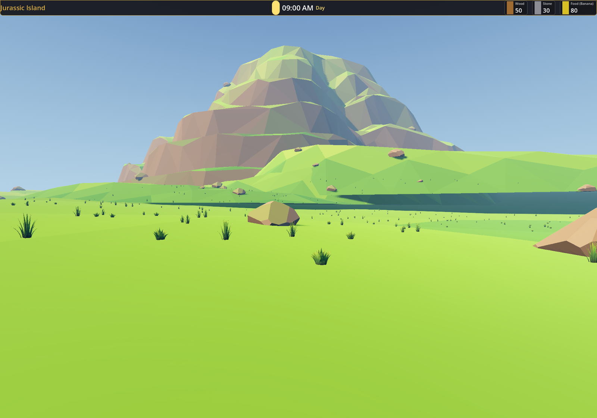
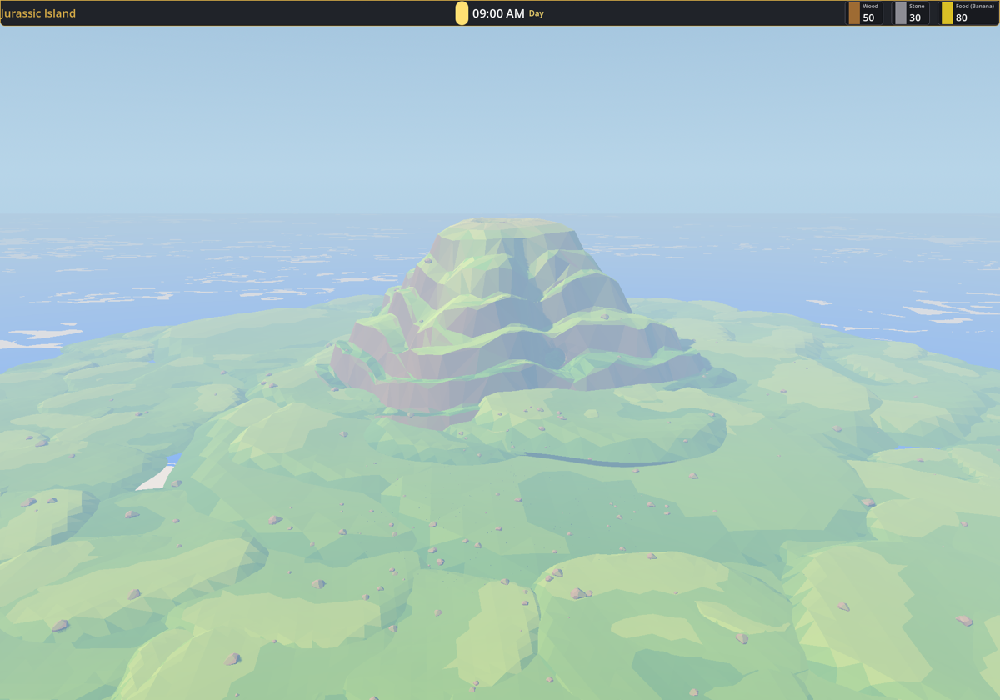

# Jurassic-island 主场景（2000 m，静态配置）





主场景**没有运行时脚本**。2000 m 岛体、12 km 海、玩家出生点、静态草石、灯光/环境
全部写在 `.tscn` / 子场景里，打开编辑器就是最终状态。

## 场景组成

| 部分 | 实现 |
| --- | --- |
| 岛 | `components/island/island_terrain.tscn`；`Island` 节点水平 scale **32.258**（62 m 组件 → 2000 m），竖直 scale **20.968**（水平的 0.65） |
| 海 | `components/sea/sea.tscn`，PlaneMesh **12000 × 12000**，关闭阴影投射 |
| 玩家 | `scenes-3d/player/player.tscn`，静态出生点 `(0, 20.5, 650)`；相机 `current = true`、`far = 12000` |
| 本地草石 | `scenes-3d/jurassic-island/local_scatter.tscn`：720 丛草 + 180 块石头，静态节点；石头共用一个三角面碰撞形状 |
| 环境 / 灯光 | 主场景自己的 WorldEnvironment + Sun + FillLight + BounceLight，雾密度 **0.0005** |

## 为什么之前第一人称玩家“看不见”

展示版 `components/island/island.tscn` 自带一个 `PreviewCamera`（`current = true`）、
一套 WorldEnvironment 和三盏灯。放大后直接放进主场景时：

- 预览相机会抢走第一人称视角；
- 两套环境光/太阳叠加，画面过曝；
- 组件里按 62 m 场景做的草石乘 32 倍后，会变成二十多米高的巨草、几十米宽的巨石。

现在主场景改用 **地形版 `island_terrain.tscn`**：只保留 `IslandBase` / `Ground` /
`Mountain`，没有预览相机、没有环境/灯光、没有巨型草石。主场景自己的相机、灯光、
静态草石接管画面。

## 静态配置细节

1. **岛体**：`Island` 节点的 `Transform3D` 直接写着 2000 m 的缩放和 `y = -0.5`；
   地形版子场景只包含岛体、116 块草毯、山。
2. **玩家**：`Player` 节点在 `(0, 20.5, 650)`，落在地面约 `19.5`，面朝岛心山体。
   相机 `current = true`、`far = 12000` 写在 `player.tscn`；可站立坡度
   `max_floor_angle_deg = 50` 写在 `player.gd`。
3. **本地草石**：`local_scatter.tscn` 是烘焙好的静态场景，720 草 + 180 石；
   每块石头的 `CollisionShape3D` 共用同一个 `ConcavePolygonShape3D` 资源。
4. **海 / 视野**：12000 m 海面 + 12000 m 相机远裁剪 + 0.0005 雾密度，
   约 6 km 外基本全雾，海面边缘不可见。
5. **岛组件碰撞**：地形版仍然挂 `components/island/island.gd`，由组件自己在运行时
   给 `Ground` / `Mountain` 补三角面碰撞（这是组件级行为，主场景本身没有脚本）。
   本地草石碰撞已经烘进 `local_scatter.tscn`，不依赖脚本。

## 关键比例

| 项目 | 值 |
| --- | --- |
| 岛体 footprint | 2000 m × 2000 m |
| 中央山 | 约 327 m 高（组件内 503 m × 0.65） |
| 海面 | 12000 m × 12000 m（岛外半径 5000 m） |
| 相机远裁剪 | 12000 m |
| 雾密度 | 0.0005 |
| 玩家出生 | `(0, 20.5, 650)`，面朝岛心 |
| 基础地形最大坡度 | 网格抽查 1724 点，最大 **44.1°**；玩家可站立 50°，不用跳 |

## 为什么岛看起来是“绿色海岸线”而不是棕色岩台

岛体台面在 `y = -0.5`，刚好在海平面以下；海面把台面外圈那圈棕色平边盖住，
露出来的是抬高的绿色地形块。于是海岸线是绿色地形入水，而不是一圈裸露的岩台。

## 自检

```bash
/Applications/Godot.app/Contents/MacOS/Godot --headless \
  --script res://scenes-3d/jurassic-island/tests/verify_jurassic_island.gd
```

40 项检查：主场景无脚本、2000 m 岛体比例、海面尺寸、玩家出生 / 相机 / 站在地面、
地形版没有展示节点、静态草石数量与碰撞、基础地形坡度 ≤ 50°、环境与太阳设置。
全部通过时退出码为 0。

## 后续

- 海面是单张 12000 m 平面，UV 波纹在大尺度下会被拉伸；后续可以给
  `ocean_visual_shader.tres` 加 UV scale，或换成远/近两层海。
- 当前玩家没有水中物理；走到海里会直接往下掉。后续加水体碰撞/游泳即可。
- 静态草石约 900 个节点；正式关卡可以换成 `MultiMeshInstance3D` 或按距离减少。
